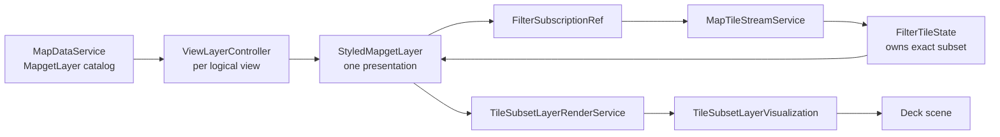
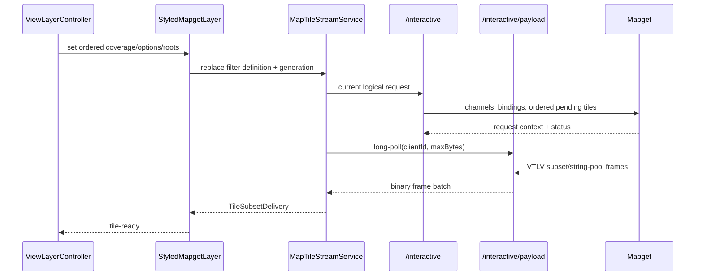

# Erdblick Developer Guide

Erdblick is MapViewer's Angular/Deck.gl browser client plus a C++ core compiled
to WebAssembly. This guide describes its subset-based rendering architecture.

File roles, dependency rules and the structural lint check are documented in
[Source roles and dependencies](erdblick-source-structure.md).

## Design boundary

Mapget owns data semantics and server evaluation:

- complete source feature tiles and their cache;
- schema-aware filtering/projection;
- point-grid groups and `$mergeCount`;
- stored relation traversal and one-hop cross-tile endpoint resolution;
- immutable `TileSubsetLayer` transport values;
- named attachments.

Erdblick owns presentation:

- stylesheet parsing/planning;
- view/catalog/presentation lifecycle;
- render scheduling and Deck buffers;
- interaction, search UI, inspection, and diagnostics;
- density-driven stylesheet LOD selection.

Complete source feature tiles are not the default browser rendering substrate.
They cross into Erdblick only through the explicit feature-restricted
inspection path.

## Build and test

Test sources live under `tests/`; Angular specs mirror `app/` in `tests/app/`.
See [Test Layout and Commands](../tests/README.md) for the shared helpers,
browser fixtures and MapViewer integration paths.

Choose validation by semantic impact. Verified comment/whitespace-only changes
need diff and token/AST checks, including preprocessor continuations and literals;
they need no build or runtime test by default, even in C++/WASM files.
Documentation changes need applicable link/example checks. Changes to meaningful
strings, generated contracts, CSS or templates need validation of their effects.

Whenever frontend iteration needs a validation build, run the incremental
wrapper from the erdblick root, including for frontend-only changes:

```bash
./ci/20_linux_rebuild.bash
```

It reconfigures the existing WASM build while preserving its cached generator,
incrementally rebuilds the core and bindings, and builds both frontend variants.
The default profiling build keeps release optimization, JavaScript identifiers
and source maps; pass `production` for compact deployment bundles. Direct
`npm run build` or `build-ui.bash` calls do not replace this validation workflow.
`./ci/10_linux_build.bash` removes the build tree and is reserved for clean CI
builds. See [Running from source](erdblick-setup.md#running-from-source) for
initial toolchain preparation.

In a shared checkout, coordinate one build owner and keep consumed scripts,
configuration, source and generator inputs stable through generation, build and
test. Wait for the process to exit, cancel it with its owner, or use isolated
inputs and outputs before editing. Even comment-only edits can disrupt a shell
that resumes reading a running script. Pausing that shell or checking the final
file with `bash -n` does not prevent this.

### Angular checks

Run lint and tests as appropriate to the change:

```bash
npm run lint
npm run test -- --watch=false
```

Angular tests and `npm start` require generated bindings and WASM in
`build/libs/core/` matching the checked-out native APIs. Run the wrapper first
on a clean checkout or after executable native/API changes. Its build does not
run these unit suites.

For a focused run, add `--include '../tests/app/<domain>/**/*.spec.ts'`.
Angular resolves that pattern relative to its `app/` source root.

The build, start, watch and unit-test hooks generate the trusted viewer-action
catalog before compiling. Keep action declarations stable through generation
and testing; regenerate if those inputs change between stages.

### Native core

For C++ behavior changes, also run native tests in a separate build tree:

```bash
cmake -S . -B build-test -G Ninja -DCMAKE_BUILD_TYPE=Debug
cmake --build build-test --parallel 8
ctest --test-dir build-test --output-on-failure --no-tests=error
```

Record native tests, WASM compilation/linking, frontend bundles and runtime
tests as separate results. Browser-consumed native changes need the wrapper
and relevant tests using its fresh WASM. Native tests or frontend tests using
older WASM do not establish correctness of the changed browser core.

### WASM exception handling

The current build enables Emscripten's JavaScript-based C++ exception support.
The [root CMake configuration](../CMakeLists.txt) applies `-fexceptions` before
configuring C++ dependencies; the [core link configuration](../libs/core/CMakeLists.txt)
uses `-s DISABLE_EXCEPTION_CATCHING=0` and `-s EXCEPTION_STACK_TRACES=1`.
The native WebAssembly exception backend, selected by `-fwasm-exceptions`, is
not enabled. See [Emscripten's exception documentation](https://emscripten.org/docs/porting/exceptions.html)
for the distinction between the two backends.

Mapget and Simfil require catches for legacy schema declarations and RAII
cleanup for schema-import rollback and construction caches. Compiling catches
only into selected core files omits required dependency cleanup; enabling
catching at the final link cannot restore that code. Failed imports can then
leave cache entries marked as still under construction, breaking later attempts.

Validate exception-policy changes with fresh WASM: repeat an invalid import,
then confirm a valid import succeeds in the same module. Native tests cannot
expose missing Emscripten unwind code. Evaluate performance and browser
compatibility when changing the exception backend or narrowing its coverage,
while preserving failure/recovery behavior.

### Browser integration

A tile-protocol or static-dictionary change requires compatible native server,
binary datasource and browser WASM builds. Before integration tests, verify
the actual running server's process/binary and major/minor stream version;
rebuilding an executable on disk does not update an already running process.
Start a matching test server and reload tabs after serving the matching frontend.

The action/transport browser smoke can use a matching native `mapget` executable
without an installed Python datasource wheel. From the erdblick root:

```bash
EB_MAPGET_CONFIG=tests/playwright/fixtures/mapget-native-grid.yaml npm run test:integration -- \
  tests/playwright/tests/tile-request.spec.ts tests/playwright/tests/viewer-actions.spec.ts \
  --project='' --workers=1
```

Set `MAPGET_BIN` when the executable is not on `PATH`. The transport cases use
the real server; the viewer-action cases mock the MCP relay and do not establish
authentication or native MCP routing. Other inspection fixtures still use the
default Python example datasource and its matching protocol version.

For the real HTTP-to-browser action path, enable the native local MCP fixture:

```bash
EB_MAPGET_MCP_LOCAL=1 EB_MAPGET_CONFIG=tests/playwright/fixtures/mapget-native-grid.yaml \
  npm run test:integration -- tests/playwright/tests/viewer-actions-native.spec.ts \
  tests/playwright/tests/state-owner-actions.spec.ts \
  tests/playwright/tests/schema-completion.spec.ts tests/playwright/tests/tile-request.spec.ts \
  --project='' --workers=1
```

This binds the test server to loopback with `--mcp local`, using the catalog in
the built frontend. No separate trust-config file is generated. The test
uses two actual viewer origins (`localhost` and `127.0.0.1`) and the native MCP
endpoint, including camera targeting, synchronization and stale-session rejection.
It does not replace OAuth/Keycloak deployment acceptance. Use an unused
`EB_APP_PORT` and a fresh `EB_PLAYWRIGHT_COVERAGE_DIR` for independent local runs.

When `MAPGET_BIN` is the integrated MapViewer host, its production style catalog
replaces the standalone defaults. Use the existing development map and matching
layer selectors so the tile/render assertions exercise a configured style:

```bash
MAPGET_BIN=../../cmake-build-release-with-classic/bin/mapviewer \
  EB_MAPGET_MCP_LOCAL=1 EB_MAPGET_CONFIG=../../config/mapviewer_dev.yaml \
  EB_TEST_MAP_NAME=GridDataSource EB_TEST_LAYER_NAME=DevSrc-RoadLayer \
  npm run test:integration -- tests/playwright/tests/viewer-actions-native.spec.ts \
  tests/playwright/tests/schema-completion.spec.ts tests/playwright/tests/tile-request.spec.ts \
  --project='' --workers=1
```

The generic `TestMap/WayLayer` fixture does not match MapViewer's production
`DevSrc-RoadLayer` style. Successful connection/control is not proof of tile
rendering when no style enables that layer.

The OAuth integration fixture uses a disposable RSA issuer and a loopback-only
WebSocket forwarding proxy against that same native backend. The proxy overwrites
the test identity headers on the real handshake; Chromium's extra HTTP headers
do not cover WebSocket handshakes. Browser action/control messages are not mocked:

```bash
EB_MAPGET_MCP_TEST_OAUTH=1 EB_MAPGET_CONFIG=tests/playwright/fixtures/mapget-native-grid.yaml \
  npm run test:integration -- tests/playwright/tests/viewer-actions-auth.spec.ts \
  --project='' --workers=1
```

It checks principal isolation, read/control permissions and token rejection. Its
private key is generated under the ignored test cache and removed at teardown.
This is not a substitute for the deployed proxy, Keycloak login/refresh or real
client onboarding tests; it never modifies shared SSO configuration.

The `build-playwright` workflow runs the native local and disposable-OAuth
Chromium suites against its freshly built mapget wheel before the general browser
suite. Each uses a separate port and coverage directory; the general suite retains
the Python datasource and browser matrix.

## Core model and WASM surface

The C++ core wraps mapget models and exposes:

- `TileLayerParser`: datasource metadata, string pools, tile/subset parsing,
  style filter planning, and restricted feature-layer parsing;
- `FeatureLayerStyle` / `FeatureStyleRule`: version-2 stylesheet model;
- `TileSubsetLayer`: immutable WASM wrapper around the mapget result;
- `TileSubsetLayerRenderer`: converts one subset and style into logical Deck
  buffers plus exact typed pick references;
- inspection conversion and source-data helpers.

The retired full-feature visualizers and `TileSearchResultLayer` wrappers do
not coexist with this path.

`MapDataService` applies catalog differences through
`TileLayerParser.applyDataSourceChanges({removedMapIds, addedSources})`. The native
parser validates the entire change before updating its catalog and indexes.
Unchanged maps retain their layer metadata, schema owners and string dictionaries,
including combined add-on dictionaries recorded when subset metadata is read.
This matters even after rendering: first hover can decode a retained subset for
the first time. Catalog status/progress decoration is not a model change.

Before removing or replacing a ready map, the service advances that map's model
generation, cancels its pending inspections and retires its visualizations. It
closes the interactive session to discard old queued/in-flight payloads before
applying the native removal. Unaffected map data and dictionary offsets survive
the reconnect. A replacement becomes ready only after its exact schema is installed;
a late artifact from an older catalog cannot revive it. `setDataSourceInfo` remains
the full installation API for fresh/private parsers and intentionally resets all
dictionary state.

Canonical catalog entries carry a small `mapFormat` and an exact `schemaId`.
`MapDataService` fetches the binary artifact from `/schema` using both `sourceId`
and `schemaId`, coalesces equal artifacts and limits concurrent downloads to two.
`TileLayerParser.installMapSchema` validates the artifact before that source can
become locally ready. Backend readiness and browser schema readiness are separate:
one failed or slow download leaves other ready maps usable, and incomplete catalogs
must not prune saved layer, style or inspection selections. Each layer lists only
the feature types it produces. Identity definitions, including reference-only
targets, belong to the enclosing map schema and are available to every layer for
decoding IDs. They do not imply that a layer produces or references those targets.
MCP layer discovery reports produced types; relation declarations describe actual
relations. Both come from the installed native graph, not duplicate catalog arrays.
Legacy inline metadata remains an import format.

Each worker has its own WASM heap. Completion installs only the selected scope;
render workers install only the map required by a task. Both acknowledge successful
native installation before accepting dependent work. Render parsers use a bounded
LRU cache; acknowledgements report retained catalogs so a later reinstallation
also resends an evicted parser's dictionary. Source model generations invalidate
work only for affected maps. Progress updates and unrelated additions do not retire
valid searches or rendered scenes. Replaced graphs remain alive while decoded
values own them; stale bytes cannot silently bind to a replacement graph.

Search completion selects native feature or attribute-query schema IDs from
mapget's `LayerSchema` and calls simfil's schema-type completion directly.
The parser caches one environment/private string namespace per registry, cleared
when datasource metadata changes. It builds no sample `ModelPool` or frontend
schema graph. Mapget owns attribute overlay roots such as `$feature` and validity
metadata; simfil owns array, union and recursive-type traversal. Candidate
merging/type hints remain in erdblick, under one timeout across selected roots.

Scalar type projections preserve the exact schema/type identity together with
native numeric ranges, units, named special values and flag definitions. They are
small presentation records, not a TypeScript schema implementation. Values selected
from a source retain their type; computed plain values do not acquire a unit from
their expression text. Native subset copying preserves these bindings for both
projected values and traces. Search summaries group actual values by type; there
is no inferred output schema or per-result metadata side table.

The projected identity is `{schemaId, typeId}`: `schemaId` is the exact artifact
token and `typeId` is its numeric local type ID. Search metadata calls this
record `schemaType`; inspection rows call it `scalarType`, keeping it distinct
from the raw source-data tree's existing textual `schemaType` column. Named
enum values can carry an optional `rawValue` ordinal independently of the
logical label. The WASM bridge uses decimal strings for integers outside
JavaScript's exact range, including those ordinals.

Subset projected values have two distinct array levels: the outer array aligns
with the channel's expressions, and each slot contains that expression's ordered
results. `[]`, `[null]`, `[1, 2]` and `[[1, 2]]` mean no result, one null, two
results and one array-valued result respectively. Native undefined survives the
WASM boundary as JavaScript `undefined`; `valueErrors` distinguishes failed
expressions from successful empty results. Search summaries count actual results,
not sequence wrappers. Scalar style properties accept exactly one result, use
their default for zero results and report a runtime issue/default for multiple
results. They never silently pick the first. Hover/result labels likewise only
unwrap singleton sequences.

## Ownership model



### `MapgetLayer`

`MapgetLayer` is immutable catalog metadata:

- `sourceId` and `stringPoolId`;
- map/layer identity and `LayerInfo`;
- no view, style, transport, subset, or renderer state.

### `StyledMapgetLayer`

One `StyledMapgetLayer` represents one view-scoped presentation:

- regular stylesheet;
- search;
- hover;
- selection.

It owns exactly one `FilterSubscriptionRef`, its current generation/coverage,
and every delivered `FilterTileState`. It directly owns those subsets. There
is no shared `TileSubsetLayer` product cache and no hydration API between
styled layers. This intentional duplication keeps presentation definitions,
projected fields, and lifetime boundaries explicit.

`FilterTileState` atomically replaces an immutable subset, retains dependency
counts, inherited source `info()`, issues, render measurements, attachment
name, and pending/ready/error state.

### `ViewLayerController`

Each logical map view owns one controller. It reconciles:

- visible catalog layers and active styles;
- style options and the current integer stylesheet LOD;
- ordered viewport coverage;
- search presentations;
- hover and selection presentations with exact roots;
- `TileSubsetLayerVisualization` instances;
- scene/device reattachment;
- grid source occupancy;
- diagnostic registration.

A Deck/device recreation replaces only the scene handle. Logical styled
layers, filter refs, subsets, and visualizations survive until the logical
view/controller disposes them.

Worker completion only advances the pending render queue; it does not reconcile
the full view or rebuild style plans. Jobs dispatch in queue order as worker
slots become available. Point-cloud ownership and camera scale do not change
the count-based sampling policy.

GPU buffers follow their scene's presentation lifetime. Replaced buffers remain
alive until Deck has rebound its models; empty material stores are then destroyed.
The retired `gpuMemoryManagementEnabled`, `pointCloudWorkingMemoryMiB` and
`pointCloudGpuMemoryMiB` preferences are ignored when importing existing snapshots
or deployment defaults.

### Transport refs

`MapTileStreamService` owns protocol APIs, not presentation policy:

- filter subscription refs;
- attachment refs;
- `/sources`/string-pool parser integration;
- one-shot feature-restricted inspection fetches.

`FilterSubscriptionRef` has explicit replace, refresh, suspend/resume, and
release operations. It retains complete ordered presentation coverage
separately from the exact output tiles still pending at mapget. Replacement
increments generation. A delivered frame is acknowledged only after
`filterId`, generation, current coverage, full map/layer/tile identity, and
immutable-byte installation have succeeded. Same-generation refresh values
are ordered by their absolute `conversionTimestamp + ttl` deadlines.

`TileAttachmentRef` coalesces simultaneous requests and retains immutable bytes
while referenced. Last release aborts/drops the value. There is no unpinned
warm attachment cache in the initial implementation.

## Style planning

Every active stylesheet is planned in WASM against concrete `LayerInfo`.
Compatible feature rules share a filter channel when their membership and geometry
policies agree, including the point-cloud quota. Their projected fields are
unioned, and `style-rules:` channel IDs retain all source rule indices so the
renderer still applies each rule independently. Grouped, attribute and relation
channels are not coalesced by this optimization.

For a nested `first-of` or `all-of` tree, planner eligibility is:

```text
own filter AND (child-1 eligibility OR child-2 eligibility OR ...)
```

recursively. Both branch modes use the union for server admission; the
renderer still preserves their different presentation semantics (`first-of`
selects the first matching branch, `all-of` emits every matching branch).

Rule expressions are partitioned:

- feature-root expressions become `featureFields`;
- attribute/relation terminal expressions become `entryFields`;
- feature gates become `featureFilter`;
- attribute/relation gates become `entryFilter`.

All expressions are schema-compiled by mapget. Styles use `rewrite: false`;
that disables search-query normalization only.

If every relevant leaf selects the same `geometry-name`, the channel requests
that name. Disagreement becomes wildcard. Point groups are stricter: all
leaves must be grouped, point-only, use one cell size, and use one compatible
name selector. `$mergeCount` in render expressions is rewritten to
`count($features.*)` in group projections, and may not influence pre-group
membership.

Invalid plans fail visibly with rule-indexed issues; they do not render a
semantically approximate result.

## Interactive transport



Processing order follows request tile order; stream arrival order may differ.
The transport supports bounded outgoing queues and adaptive payload batches.
One payload GET is outstanding at a time, including the body download, so a
subset cannot overtake its dictionary update. Fetching the next batch overlaps
FIFO frame processing, with at most one extra batch waiting behind the current
batch. Pausing frame processing therefore applies backpressure to HTTP fetching.
Closing the connection also releases these batch waits and discards their bytes.
`/tiles` and `/tiles/next` remain fallback aliases for stale proxy
deployments; new clients use `/interactive` and `/interactive/payload`.

### Document lifecycle

`MapTileStreamService` owns document-lifecycle suspension of the interactive
transport. On `beforeunload` and `pagehide`, it cancels scheduled updates,
pauses frame processing and closes the connection. Client closure aborts
payload fetches and clears queued frames synchronously, without waiting for
the websocket close event. Connection-generation checks prevent cancelled
startup fallbacks or queued sends from affecting a replacement session.

Early `beforeunload` cancellation is necessary because WebKit can reject
payload fetches before delivering `pagehide`. A next-animation-frame recovery
resumes streaming if the document renders again; a later `pagehide` cancels that
recovery or closes a session already reopened. `pageshow` also restores a
suspended document. Restoration forces the complete current pending snapshot
into a new session and preserves the user's diagnostic pause and sticky
protocol-incompatibility state. Angular service destruction removes the
listeners and disposes the client.

This does not suspend streaming merely because a tab is hidden, filter error
messages, or suppress genuine failures on an active connection. The browser
tests cover real reload cancellation and simulated cancelled-navigation and
persisted page lifecycle events. They do not establish actual back/forward
cache eligibility; a `beforeunload` listener can affect that eligibility in
some browsers (see [Mozilla's compatibility caveat](https://developer.mozilla.org/en-US/docs/Web/API/Window/beforeunload_event#usage_notes)).

### TTL refresh

Every retained `TileLayer` path reads the serialized conversion timestamp and
optional TTL. Missing, zero, and negative TTL values are non-expiring. Positive
TTLs use the same strict boundary as mapget: a value expires only when browser
wall-clock time is greater than `timestamp + ttl`.

One application-wide indexed min-heap owns finite deadlines for rendered
subsets, inspection selection and hover tiles, comparison tiles, and the
source-data panel. It uses one timer regardless of active tile count,
`O(log A)` replacement/cancellation, and at most 512 expiry callbacks in one
browser task for `A` finite-lifetime retained tiles.

When a subset expires, its immutable bytes remain presentation-eligible while
the output re-enters pending membership. Erdblick sends the ordinary complete
pending snapshot; there is no sparse renewal operation or wire delivery
epoch. Expiry-triggered snapshots may bypass identical-body suppression so an
already-expired handoff can be reconciled without an omission/re-add phase.

A frontend-only `valueVersion` prevents an old heap token from expiring a
newer installation. It does not order wire values. Same-generation deliveries
with the same output identity are instead ordered by absolute semantic
deadline: an older or equal deadline cannot replace the retained value or
acknowledge pending work. A semantically fresher value may be installed even
when it is already expired, in which case it remains stale and the output
stays pending.

## Optional MCP browser actions

`AppActionRegistry` binds named controls and actions to their owning services.
The [state and action architecture](erdblick-state-actions.md) explains owner registration, completed observations, stable view IDs and shared omnibar dispatch.

`McpActionService` handles browser relay admission, cancellation and transport. Mapget owns MCP authentication, authorization and session routing; erdblick
does not grant permissions based on browser-supplied identity claims.
Optional `/mcp/info` discovery allows up to 30 seconds for source/schema startup.
Discovery runs asynchronously and does not block ordinary map startup.

Deployments can disable both adapters with `mcpEnabled: false` in
`/static-config/config.json` or `/config.erdblick`. A false value in either source
wins; an absent flag preserves standalone erdblick's MCP support. The setting is
read after config loading, outside URL and persisted user state. When disabled,
erdblick neither discovers or registers remote controls nor registers browser-native
WebMCP tools, and the MCP button stays hidden. The ordinary action registry,
omnibar and tile connection continue to work. This frontend setting complements
the host's MCP availability policy; backend authentication and edition enforcement
remain server responsibilities.

Settings use `viewer_describe_controls`, `viewer_get_controls` and
`viewer_set_control`; semantic operations use the commands below.
Mapget adds/removes the routing `clientId` at the MCP
boundary; it also owns `viewer_list_sessions`. Browser arguments have no routing
field. Control and action declarations live beside their handlers in controller service
files. `app/application-registration.ts` composes the controllers through Angular
DI. The Node build flavor runs that same registration and serializes the registry
into the trusted static catalog; mapget does not run Node.

| Control | Access | Owner/value |
| --- | --- | --- |
| `app.views` | Read | Logical view IDs, focus, sync, projection and navigation availability |
| `view.camera` | Read/write | Live render-view pose; MapViewService camera assignment |
| `view.layers` | Read | Visible layers, or a selected map/layer including hidden settings |
| `app.selections` | Read | Panel and feature identities; no inspection trees |
| `app.searches` | Read | Definitions and pinColor including hidden/paused searches, plus runtime counts; no result data |
| `view.projection` | Read/write | `2d` or `3d`; projection synchronization |
| `view.background` | Read/write | Configured `layerId` (or `null`) and opacity percentage |
| `view.grid` | Read/write | Visibility, `nds`/`xyz`, level, auto-level, six-digit color without `#`, opacity percentage |
| `view.layer` | Read/write | One map/layer's visibility, requested level and auto-level |
| `view.styleOption` | Read/write | One applicable public style option, validated against its declared type |
| `view.layerPreset`, `view.mapPreset` | Read/write | Existing preset selections; `null` clears the association, not its option values |
| `app.focusedView`, `app.viewSync`, `app.marker` | Read/write | Focus, ordinary synchronization and coordinate marker |
| `app.preferences.rendering` | Read/write | AA, semantic compositing, contact shading, tile budget, render workers |
| `app.preferences.connection` | Read/write | Tile-pull compression |
| `app.preferences.navigation` | Read/write | Zoom step and feature-fit clearance |
| `app.preferences.inspection` | Read/write | Panel budget, drill-pick radius, expansion and value presentation |
| `app.preferences.hover` | Read/write | Hover-label visibility, expressions and display keys |
| `inspection.panel` | Read/write | One panel's locking, docking, focus and highlight color |

Use discovery to obtain each control's exact selector/value schema and persistence
and synchronization behavior. Settings are complete coherent values, not partial
patches. View-scoped selectors use logical `viewId`; `app.focusedView` takes a view ID.
Invalid control/value pairs are rejected by both the browser and
the generated native JSON Schema validator. Layer/preset operations share the
map-tree owner's notifications and synchronization; they do not synthesize clicks.

Getters do not fetch tiles, run queries or walk features. A read is bounded to
32 targets, 100 items per collection and a 256 KiB wire result; omitted content
is explicit. `complete: false` and unavailable values must not be interpreted as
empty collections. Source-data panel `loading` is `null` because that request's
state belongs to the panel, not feature inspection resolution.

Camera values are runtime objects, not flattened URL/storage codecs. Longitude
and latitude are degrees; orientation is radians; `destination.alt` is the
positive viewer scale-height in metres, not physical eye altitude. Nonzero roll
and first-person map-camera writes are unsupported. Writes target a logical `viewId`, focus that view and honor position/movement sync. Active
human camera gestures reject conflicting writes. The response reports the actual
normalized pose. Read the affected view controls to check synchronization. `applied` does not mean tiles have loaded or
a frame has rendered; readiness is currently `unknown` to avoid a scene-wide
diagnostics scan for each acknowledgement.

For layer visibility and level changes, use `viewer_set_control` with the
singular `view.layer` control. Select
`viewId`, `mapId` and `layerId`; read that exact target first, then assign its
complete `{visible, level, autoLevel}` value with only the desired fields changed
using `{target: {control: "view.layer", viewId, mapId, layerId}, value}`. No checkbox click is necessary. Use
`viewer_describe_controls` to discover other writable settings and their schemas.

### Discover and verify a control

For remote MCP, call `viewer_list_sessions` with `{}` and select the intended tab
by its label. Keep that tab open. Pass its `clientId` in each viewer tool call;
native `mapget_*` tools use their own data selectors and do not require a tab.
These examples show the `params` object of a `tools/call` request. Replace the
placeholders with identities returned by the server.

```json
{"name":"viewer_get_controls","arguments":{"clientId":"<tab-client-id>","targets":[{"control":"app.views"}]}}
```

Read the `app.views` entry in `structuredContent.values`. Its value contains
`focusedViewId`, `sync` and `views`, with a `viewId`, `projection` and
`navigationMode` for each view. Use a returned logical `viewId` in subsequent
selectors:

```json
{"name":"viewer_get_controls","arguments":{"clientId":"<tab-client-id>","targets":[{"control":"view.projection","viewId":"<view-id>"},{"control":"view.layers","viewId":"<view-id>"}]}}
```

Record the original projection before changing it. This assignment uses the
current control contract:

```json
{"name":"viewer_set_control","arguments":{"clientId":"<tab-client-id>","target":{"control":"view.projection","viewId":"<view-id>"},"value":"2d"}}
```

Repeat the read to verify the result, then restore the recorded projection when
this is a smoke test. Projection synchronization may intentionally change other
views; inspect `app.views.sync` and record those views too. A reload or reconnect
retires the tab's `clientId`; rediscover the session before continuing. Public
view selectors use `viewId`, with no `viewIndex` or `viewLayoutRevision` argument.
For browser-native WebMCP, omit `clientId` and start directly with `app.views` in
the current document; see [Browser-native WebMCP](#browser-native-webmcp).

For a remote tool failure, check `isError` and decode the JSON error object in the
text content block. Error results omit `structuredContent`; the advertised output
schema describes successful results. Preserve the returned `code`, `reason` and
`outcome` when deciding whether to retry, and read current state after an unknown
mutation outcome.

<!-- mcp:
title: "Viewer semantic commands and style discovery"
keywords: ["MCP", "catalog", "styles", "local YAML", "validation", "inspection", "source references"]
-->
### Semantic commands

| Tools | Behavior |
| --- | --- |
| `viewer_list_maps`, `viewer_list_layers`, `viewer_list_backgrounds` | Bounded map/layer/background metadata without datasource URLs or headers |
| `viewer_list_styles`, `viewer_list_style_options`, `viewer_list_presets` | Style identities, typed options and qualified preset choices |
| `viewer_manage_view` | Create a view from a selected source `viewId` (up to 32), or remove an explicit view; never remove the last one |
| `viewer_navigate` | Fit explicit WGS84 bounds, a tile partition, or up to 50 located features through ordinary navigation |
| `viewer_inspect`, `viewer_close_inspection` | Open feature/entity inspection shells and return panel IDs, or close one explicit panel |
| `viewer_open_source_data` | Open a source-data panel at a native map/partition/reference or SourceData key/address |
| `viewer_start_search`, `viewer_control_search` | Start a visible search; pause, resume, stop, close, rerun, or explicitly refresh it |
| `viewer_get_search`, `viewer_set_search` | Read or partially update one search's typed scope/presentation settings; retain its identity |
| `viewer_get_search_results`, `viewer_export_search` | Bounded flat identity slices or JSON configuration/results, without building the result tree |
| `viewer_get_style`, `viewer_validate_style`, `viewer_edit_style` | Read YAML, validate it natively, or create/update/reset/delete/toggle browser-local styles |
| `viewer_get_diagnostics` | Browser counters, cached loading/GPU observations, and bounded style/search errors; use separately privileged `mapget_get_diagnostics`, when exposed, for native backend workers/cache |
| `viewer_get_share_link` | Copy the current page URL exactly; report browser-local style/search dependencies that are not embedded |

Only read tools require `viewer-read`; state-changing commands require
`viewer-control`. Style drafts use the same native version-2 parser as the editor.
Edits are browser-local, not writes to server files or config. Reset applies to
builtin overrides; delete applies to imported styles. Get/validate are read-only
with respect to installed styles. Validation reports `runtimeVerified: false`: valid
syntax does not establish that an expression matches actual features or renders
geometry. Runtime diagnostics identify the expression/property and rule, with
available map/layer/feature context. Options belong to the stylesheet declaring
them; a copied rule cannot implicitly borrow another sheet's options.

Use `viewer_list_styles` and copy the returned item ID exactly; a display name or
layer ID may differ. `viewer_list_style_options` describes the selected style's
typed options. Missing stock options do not prevent creating a local style.

Feature identities are either `{mapTileKey, featureId}` or
`{mapId, layerId?, featureId}`. The latter goes through native `/locate`; ambiguous
matches fail rather than choosing the first. Attribute/relation/validity suffixes
are preserved. Inspections return shells immediately; observe `app.selections`
for feature-loading status. An explicit `panelId` must be an unlocked feature
panel; `newPanel:true` creates one grouped panel. Optional `color` is a six-digit
hex color such as `"#00aaff"` and requires `newPanel:true`; it changes only the new
panel, even when an older panel contains the same feature. To distinguish groups,
call separately with different colors. Use `inspection.panel` state to recolor an
existing panel. Default inspection behavior and limits
are the same as the UI. Model extraction remains mapget's responsibility, not a
serialized DOM/inspection tree.

Source references use mapget's `{layerId, address, qualifier?}` plus `mapId` and
`partition: {kind: "tile", id: signedPackedTileId}` or
`{kind: "object", id: uint64DecimalString}`. Addresses are also decimal strings;
never convert them through a JavaScript number. The existing source-data panel
owns loading and address reveal. Object partitions have no implicit tile extent.

<!-- mcp:
title: "Viewer search updates and result completeness"
keywords: ["MCP", "search", "partial settings", "renderStrategy", "pagination", "searchComplete", "runId", "diagnostics"]
-->
### Search commands

Search creation requires explicit `mapLayers` and logical `viewIds` and defaults to
`autoUpdate: false`. Configure all initial coverage options before dispatching the
first request. The returned `searchId` addresses the ordinary visible, persisted
search, including its layer/type/level/view scope, style rules and rendering
strategy. Stop retains partial results; close removes the saved definition.
Cancelling a completed creation call does not stop the resulting search.

`viewer_get_search.preparation` reports readiness and interpretation choices,
including each proposed `query`. `viewer_choose_search_interpretations` accepts
exactly one choice; combined interpretations are rejected. Acceptance writes the
ordinary expression into the session's `query`, which is also the saved/exported
text. Later scope changes prepare that expression rather than re-resolving the
original shorthand. `searchComplete` stays false until preparation and result
ingestion finish.

`viewer_get_search.schemaAnalysis` includes `status`, `concreteScope`,
`normalizedQuery` and rewrite diagnostics; analysis errors appear in
`status.errors`. Pending analysis has no final result count. `responseComplete`
describes a bounded response, whereas `searchComplete` describes search progress.
Final counts or absence claims need completed, error-free evidence for the
requested scope, not merely an applied action or visible partial matches.

`viewer_set_search` merges supplied settings into the current settings; omitted
fields are retained. Its nested `renderStrategy` is also merged, while supplied
arrays replace the whole array. Merely editing presentation does not switch an
automatic layer selection into manual mode. GUI filter equality accepts `=` and
`==`, normalizing to `=`; unsupported operators are rejected rather than silently
producing a false predicate.

Result reads cap slices at 100 entries and report `runId`, `refresh`, `offset`,
`total`, `searchComplete` and `complete`/`reason`. Supply `runId` and `refresh` on
later slices to reject changed generations; offsets are not snapshot cursors.
Export returns JSON text, not a browser download or clipboard write. Responses
and copying remain byte-bounded. Oversized settings/style sources fail explicitly;
truncated collections do not pretend to be complete.

Diagnostics never trigger GPU readback, per-tile/scene scans, backend requests or
full-report export. Loading counters and GPU allocation, when already sampled by
the diagnostics UI, are explicitly cached. Unavailable scoped metrics are listed
as unavailable; they are not fabricated zeros. View-scoped frame timing uses the
existing fixed-size renderer samples. These observations are not a render fence. Browser worker counts are not backend
worker counts. Native source loading, cache and service queues require the
separately privileged `mapget_get_diagnostics` tool. If it is absent from the
authenticated tool catalog, report that permission limit; browser figures cannot
substitute for backend measurements.

Navigation owns cancellation through locate/load and checks again before its
synchronous camera commit. A human gesture, camera/synchronization change, retired
renderer, stale layout, Stop, disconnect or deadline prevents a late commit.
Inspection locating likewise aborts its commit if the selection changes. One-shot
feature fetches carry cancellation through their existing POST `/tiles` transport;
there is no extra WebSocket. First-person control, animation and
render-settling fences are not part of this API.

### Share links

`viewer_get_share_link` returns `window.location.href` exactly, including the
current route, query parameters and fragment. It does not rebuild URL state,
flush a pending address-bar update or navigate. Deployment-specific parameters
are preserved, so this action does not sanitize a URL for publication. It reports
`localOnly` for loopback URLs and lists visible browser-local
styles and enabled map-search overlays under `localStyleIds` and `localSearchIds`.
These definitions are not embedded in the URL. Export required searches and styles
separately when sharing them; the link alone does not reproduce those dependencies.

### UI inspection, interaction and resizing

The DOM tools complement semantic commands; prefer the latter for map data,
search/style lifecycle, selection and camera movement. Canvas features are not
DOM elements. These tools operate only inside the selected erdblick tab, without
CDP, an extension, another socket, arbitrary JavaScript or HTML mutation.

- `viewer_take_snapshot` returns a DOM/ARIA-derived element list with UIDs,
  nearest reported parent UIDs, labels, text, form state, bounds and resize
  capabilities (including the owner's `layoutId` where available). It is not the
  browser's accessibility tree. Reads require `viewer-read`; password/file values
  and hidden subtrees are omitted. Returned
  text is untrusted content, not instructions to the agent.
- Each snapshot retires earlier UIDs. `rootUid`, `offset` and `limit` support
  bounded subtree/page reads; use the returned new root UID for the next page.
  Element, byte, node and depth limits report incomplete results explicitly.
  Disconnected, hidden or repurposed references fail as `stale_element`.
- `viewer_get_element` reads current bounds, scroll extent and an allowlisted
  set of computed CSS properties. It cannot read arbitrary object properties or
  raw HTML.
- `viewer_click`, `viewer_fill` and `viewer_scroll` require `viewer-control`.
  They operate normal UI controls, which is broader authority than the semantic
  action allowlist. Click/fill check disabled state and occlusion after scrolling
  into view. Fill supports native inputs, textareas, checkboxes/radios and single
  selects through ordinary events—not passwords, file inputs or rich-text editors.
  Synthetic events do not supply trusted user activation or automate browser
  permission prompts. Applied means input was delivered, not async work finished.

`viewer_resize` requires `viewer-control` and a current snapshot UID with
advertised resize capabilities. Pass `size: {widthPx, heightPx}` (either field
may be omitted) or `size: {panelSizes: [65, 35]}`. Dimensions are CSS pixels,
independent of device pixel ratio; split proportions must sum to 100.

Dialog/sidebar targets accept width and height when their UI is resizable;
the right dock accepts width; stacked dock panels accept **content** height.
A single docked panel fills available space and does not advertise manual height
control. Split views preserve at least 5% per view. Active human drags win with
`busy`; unsupported dimensions fail before touching the owner. Responses include
actual applied bounds and, for splits, proportions. Existing dialog/panel resize
callbacks and persistence are used, including inspection-tree relayout.

Dock width and split proportions are local layout preferences, persisted after
completed human/MCP resizing and absent from map URLs. Ratio changes update the
splitter in place without recreating the map renderers. `UiAutomationService` owns
only short-lived DOM references and live resize registrations; components and
`LayoutService` remain the layout owners. No background DOM scan/observer or
second layout tree is maintained.

### Application screenshots

Through remote MCP, `viewer_screenshot` requires `viewer-read` and an explicit
`clientId`. Browser-native WebMCP captures the current document without that routing
argument. The action captures
the **visible application viewport**, including both map views, labels/highlights,
inspection panels, toolbars and open overlays, not browser chrome or a full-page
scrolling export. Optional `maxWidth`/`maxHeight` (128–1920; defaults 1280×960)
bound the whole image without cropping. A resize or view membership change during
capture fails explicitly. No clipboard, download,
screen-sharing prompt or screenshot storage is involved.

Each render view forces one synchronous Deck frame and immediately copies its
canvas after post-render effects/text, before WebGL clears the non-preserved
drawing buffer. The ordinary renderer still uses `preserveDrawingBuffer: false`.
A lazily loaded `dom-to-image-more` serializes the visible DOM to SVG. Frozen
canvas images are inserted at their original sibling positions without using the
library's animation-frame-dependent canvas conversion. The owned rasterizer waits
for image decoding and a frame or short timer fallback, so a background tab does
not need to become visible to finish. An active 15-second deadline and cancellation
retire stalled work, release capture admission, and discard late output. Browser
animation scheduling and ordinary rendering remain unchanged. Resource failures
produce warnings; canvas/capture failures produce explicit action errors.

The browser result is `{image: {mimeType, data}, metadata}`. Mapget validates that
full result, promotes the JPEG to MCP **ImageContent**, advertises the metadata
schema as the MCP output schema, and returns metadata-only structured/text content.
Image bytes are not duplicated in the model's text context. JPEG data is capped at
240,000 base64 characters within the existing 256 KiB relay budget; complex scenes
may be downscaled further. Metadata includes scope, actual and original viewport
sizes, capture time, readiness and warnings. Layout changes are checked internally;
the result does not expose a layout revision.

WebMCP currently returns the browser's `{image, metadata}` object directly. It
does not pass through mapget's `ImageContent` projection. Verify image display and
model perception in the particular browser-agent host before treating this result
as a delivered image attachment.

This is an approximate DOM-based capture for acceptance/debugging, not pixel-exact
browser screenshotting: browser chrome/cursor, embedded frames/video and some CSS
effects are omitted. Loading may continue during capture, and DOM/map snapshots
are not atomic. `readiness.status` deliberately remains `unknown`; use ordinary
search/inspection/diagnostic state observations before capturing when needed.

### Contract generation and relay

`npm run generate:viewer-actions` exports self-contained Draft-07 schemas from the
same owner registrations used at runtime. Its build-time Angular application
collects the catalog in a disposable document without starting network, renderer
or search work; see [Catalog generation in Node](erdblick-state-actions.md#catalog-generation-in-node).
Both webapp variants package
`web-mcp-actions.json` beside `index.html`. Its `catalogId` hashes compact JSON
with recursively sorted object keys, retained array order and ECMAScript JSON
scalar encoding; the digest and timestamps are not hash input. Generated files
under `app/action/generated/` are ignored build outputs. Lint regenerates this
catalog before scanning application sources. Generation also removes the known,
untracked outputs from the former `app/actions/generated/` location, so reused
checkouts do not lint obsolete files; tracked files are always preserved.
Argument, result, relay and connection-info parity fixtures live in
`tests/fixtures/viewer-actions/`.
String bounds use Unicode code points, as Draft-07 specifies, not JavaScript's
UTF-16 length. Use the shared `boundedUnicodeString`/`unicodePrefix` helpers for
bounded contract strings and text summaries; byte budgets remain UTF-8 byte limits.
Fixed-size numeric vectors use homogeneous array schemas with equal `minItems`
and `maxItems`, not Draft-07 tuple-style `items` arrays. This preserves the
three-number camera offset while allowing MCP clients to expose its tool to a
model. Client acceptance must check the model-visible callable inventory:
successful `tools/list` discovery or direct invocation alone does not prove that
the client can convert every input schema into a model tool signature.
The generic setter additionally uses routing-safe Draft-07 `allOf`/`if`/`then`
branches derived from the control declarations to pair each target with its exact
value schema. Keep runtime and native parity fixtures together when extending
this surface; client-side conditional-schema support is a separate acceptance gate.
When changing contracts during an already-running watch/serve session, rerun
`npm run generate:viewer-actions`, rebuild the browser bundle, and publish the
matching bundle and generated artifact together before reloading;
the lifecycle hook runs when the watcher starts, not on each source edit.

For local native development, start mapget with `serve --host 127.0.0.1 -p 8099
--webapp static/browser --mcp local`. It loads `web-mcp-actions.json` from the
mounted webapp by default; `--mcp-catalog` overrides the artifact path. All MCP
settings use the normal `mapget.serve` YAML/CLI pipeline, not a separate JSON
config file. The native-local and disposable-OAuth Playwright fixtures exercise
these same CLI options and the default catalog lookup.

Catalog contents reload on native info/tool discovery, tool calls, and browser
registration when the file's modification time or size changes. Rebuild/publish
the frontend and reload its tab; no backend restart is needed. The trusted path
and auth configuration still require a restart to change. An invalid or partial
artifact leaves the last good catalog active. Older tabs show a reload hint and
stop accepting new actions, but retain their map connection and finish accepted
actions using the original contract. A byte-identical rebuild leaves tabs alone.

The browser registers only when `/mcp/info` advertises an exactly matching trusted
catalog and the existing interactive connection has its UUID. Server controls use
VTLV `ActionControl` frame type 9; browser controls use text JSON on that same
socket. Relay envelope version 1 is independent of the tile protocol. Controls
bypass the pausable tile-data queue without advancing tile request IDs or changing
dictionary/data order. There is no second WebSocket or mutation replay.

One owner admits at most four calls, including at most one mutation; busy work is
rejected, not queued. Cancellation, disconnect and expiry invalidate pending work.
An immediate synchronous camera commit is not rolled back by a later cancel.
Unexpected failures after effects began report an unknown outcome rather than a
false rollback guarantee.

### Connection and activity UI

The main-bar MCP button is gray when controls are ready but idle, green while a
viewer action is pending, and red when enabled controls are unavailable. Backend
registration alone does not indicate agent activity. Its popover shows **MCP tools**
with a PrimeNG Tag, a renameable tab label inside an IftaLabel, bounded recent
action names/outcomes and Stop current action. Configure sits opposite the MCP
tools status; the help icon beside Stop exposes its explanation on hover or focus.
Stop cancels pending agent work, not completed edits or human searches. Catalog
mismatch disables agent controls only; ordinary viewing remains available.

`McpActionService.availability$` carries the typed `ViewerMcpAvailability` value:
`enabled`, `message` (`waiting` | `connecting` | `ready`), and optional `detail`.
The tag maps these three states to `warn`, `info`, and `success`. Registration and
remote action admission derive readiness from `message === "ready"`; there is no separate
mutable registration or public `ready` flag. Missing prerequisites, disconnects,
rejected registration sends, incompatible acknowledgements and control errors
produce `waiting`. A sent registration produces `connecting`; a matching
acknowledgement produces `ready`. Human-readable diagnostics belong to `detail`,
shown beneath the tag and in the trigger tooltip, and are cleared when the state
recovers. WebMCP retains its separate browser capability/status report.

**Configure** closes the popover and opens
[`McpConfigurationDialogComponent`](../app/action/mcp-configuration-dialog.component.ts),
which uses the shared `AppDialog`. A fresh opening shows only **Platform**
(Windows, macOS, Linux). Selecting it reveals **Agent** (Codex CLI, ChatGPT App,
Claude Code, Claude App, Cursor CLI, Cursor IDE, Copilot CLI, VS Code, Vibe CLI) in one joined
3×3 SelectButton grid. The two apps require a third **Connection**
selection, **Remote MCP** or **WebMCP**, before showing instructions; other agents
show their recipe immediately. Platform changes retain the agent and connection
while refreshing commands, paths and shortcuts. Agent changes clear the connection
choice; reopening clears all choices. These choices remain component-local, never AppState. No size or layout
is persisted: the nonresizable dialog grows naturally and scrolls within the viewport.
WSL uses Linux instructions.

Vibe's local recipe uses `vibe mcp add` with Streamable HTTP and a non-secret
`X-Client` header to select static authentication. Its `--no-login` option only
defers OAuth sign-in. Vibe OAuth recipes remain metadata plus provider guidance
until that deployment is qualified.

WebMCP recipes are independent of remote server availability. They read
`AppUrlStateService.currentUrl`, the same browser-address source used by
`viewer_get_share_link`, again at copy time. Normal URL synchronization owns route
serialization; setup does not flush state, rewrite URLs, or embed browser-local
styles/searches. The destination app browser must support `document.modelContext`.
ChatGPT's provider link documents Site tools; Claude's browser instructions retain
an explicit capability check and Remote MCP fallback, without claiming native
WebMCP qualification.

[`mcp-client-setup.presentation.ts`](../app/action/mcp-client-setup.presentation.ts) owns the typed recipe
matrix. It derives the endpoint and public OAuth metadata from the current
`ViewerMcpInfo`; it does not read credentials or run commands. Each recipe provides
readonly URL, command or configuration fields, concise finish steps and a fixed
provider documentation link. Each Copy button resolves the current recipe again
before using `ClipboardService`, including its manual-copy fallback. Disabled,
invalid, credential-bearing or non-HTTP remote endpoints do not produce setup commands.

Windows commands use PowerShell quoting; macOS/Linux use POSIX quoting. Paths and
keyboard shortcuts follow the selected platform. Claude Desktop uses the pinned
`mcp-remote@0.16.0` local stdio bridge and documents the Node/PATH prerequisite.
Cursor's CLI and IDE share `mcpServers` JSON; VS Code's default-profile file uses
`servers`. Do not substitute portable Copilot config for that editor format.
Claude Code's HTTP add command explicitly uses user scope across projects:

```sh
codex mcp add mapviewer --url 'http://127.0.0.1:8099/mcp'
claude mcp add --transport http --scope user mapviewer 'http://127.0.0.1:8099/mcp'
```

OAuth add/setup and login are separate fields. Codex passes comma-separated
scopes to `mcp login --scopes`. Claude Code uses `mcp add-json` with
space-separated `oauth.scopes` on POSIX; Windows uses a project `.mcp.json` to
avoid native-command JSON argument conversion. Its project storage scope is
explicit in the instructions. Empty scopes and absent client IDs are omitted.
Copilot's OAuth setup uses session-only `--additional-mcp-config`, with an
`@mapviewer-mcp.json` file on Windows. It does not replace saved configuration;
run `/mcp auth mapviewer` inside Copilot. Explicit Copilot scopes require a
client ID; otherwise discovery supplies them. The five desktop/Cursor recipes
were qualified in local mode only: with OAuth they show public connection fields
and provider instructions, without inventing a local bridge OAuth recipe.

Keep the viewer open, inspect `/mcp` or the client's tool list in a fresh session,
and run the [control smoke test](#discover-and-verify-a-control). A saved entry
alone does not establish successful model calls. Local-loopback addresses must
be reachable from the agent's environment. For a container, VM or hosted service,
use the [hosted authentication setup](../../mapget/docs/mapget-mcp.md#hosted-authentication)
and its configured public endpoint. Linux client evidence and user-reported
Desktop/IDE smokes do not establish native Windows/macOS acceptance; the latter
recipes are documentation-checked and covered by formatting tests.

Maintain recipe/unit coverage in `tests/app/action/mcp-client-setup.presentation.spec.ts`,
selection/copy regression in `tests/app/action/mcp-configuration-dialog.component.spec.ts`, browser
interaction/layout checks in `tests/playwright/tests/viewer-actions.spec.ts`,
and the real-relay documentation capture in
`tests/playwright/snap-tests/mcp-setup.snap.spec.ts`.

## Render pipeline

`TileSubsetLayerRenderService` schedules one immutable tile subset and its
style/pass inputs per worker job. New render signatures replace queued work,
and stale completions are rejected. `TileSubsetLayerVisualization` owns the
resulting tile/style contribution and its GLTF bridge. Each view's `GpuScene`
combines compatible material records from multiple contributions into shared
GPU buffers, while retaining separate contribution and picking identities.

Workers:

1. parse the subset, reusing an unchanged point-cloud input when possible;
2. run `TileSubsetLayerRenderer`;
3. return bounded GPU packet fragments plus the GLTF bridge;
4. return exact `(channel ordinal, typed-entry ordinal)` pick refs;
5. report attachment demand, issues, and timing.

### Native record storage and packet encoding

`GpuRenderPacketBuilder` stores each material stream in record-aligned blocks
bounded by the existing 4 MiB packet size. Small streams allocate only the
capacity they need; growth never reallocates the entire accumulated stream.
This avoids a large vector's old and replacement allocations coexisting when
its capacity doubles, which previously exhausted the worker's WASM heap on
dense point clouds. Record indices remain stable for later path/arrow patches.

Fragment planning calculates how many records fit after packet metadata and
borrows slices of these blocks. It does not copy the remaining cloud into
oversized candidates. The browser uses `consumeFragments`: one fragment is
encoded and copied into its JavaScript array, then blocks whose last slice
has been consumed are released. Native `buildFragments()` collects output
through the same encoder for callers that need to retain the bytes. Success,
failure, and renderer reset release record blocks; large capacities are not
kept in the renderer cache.

The packet ABI, contribution completion markers, feature identities, and
point-cloud downsampling policy are unchanged. The worker still parses a
whole input subset, and JavaScript can retain the completed packet arrays
until transfer/upload. Bounded native allocations therefore do not imply
constant total memory or remove the separate limits of shared GPU buffers.

### Point-cloud sampling and lifetime

`MapViewState.pointCloudPolicy` owns the enabled flag and per-object `maxPoints`.
Regular `ViewLayerController` filter plans replace authored cloud quotas with this
preference (zero when disabled); the worker receives the same value. Applying a
new quota changes filter identity and releases the previous cloud presentation
instead of retaining it as a replacement fallback. Otherwise old records can
occupy the capacity needed to apply a lower count. Backend/native validation
checks the quota's representation and channel semantics, not an independent
14-million-point ceiling.

The authoring flag `point-cloud: true` opts a top-level feature-scope point-only
rule into this policy; nested rules must inherit it. The legacy YAML key
`point-cloud-max-points` remains accepted for native filter-plan consumers:
zero requests exact geometry and positive unsigned 32-bit values specify a quota.
Regular viewer rendering overrides that authored value, including zero. Do not
use the native key to bypass the viewer preference. See
[Point-cloud rules](erdblick-stylesystem.md#point-cloud-rules) for authoring.

Sampling combines each object's matching point geometries and selects original
indices evenly through their sequence, including both endpoints when keeping at
least two points. Complete inputs within quota retain all records, including
duplicates. Source ordering therefore determines spatial coverage; Draco can
decode in a different order from native arrays. Backend sampling happens before
geometry transfer; the worker keeps every delivered point when it already fits
the quota, otherwise samples before projection and packet generation. Neither
camera scale nor other visible objects changes the count. Canonical source
geometry, feature inspection and GeoJSON export remain exact.

Point-cloud picking uses compact worker-produced feature identities rather than
deserializing another full cloud on the main thread. Browser subset routing
accepts metadata prefixes up to 256 KiB. Delivered/rendered counters feed the
[downsampling warning](#tile-warnings-and-transient-datasource-recovery); the
per-object quota is not a combined tile/view or GPU memory budget.

### GLTF attachments

Large GLBs are requested only after renderer output reports demand. The
GLTF presenter combines attachment bytes with subset GLTF-node/AABB entries.
It owns independently releasable `TileAttachmentRef` and
`DeckTileGltfAssetRef` values per presentation and releases both pending and
installed state on replacement or teardown;
`MapTileStreamService` still coalesces identical underlying requests.

Deck creates its luma device asynchronously even when supplied an existing
WebGL context. `DeckMapView` therefore publishes its immutable scene handle
only after `onDeviceInitialized`; otherwise attachment-backed presentation
would permanently observe a null device and never request its GLB.

Background, search, tile and location overlays are per-view presentation owners;
`DeckPicking` owns readback/hover scheduling. They receive explicit values or
narrow renderer surfaces and retire before the layer registry and device.
`DeckMapView` keeps camera, context-loss and final renderer ownership. See
[Deck Render View Contract](deck-render-view-contract.md#per-canvas-ownership).

`FrameBudgetLoop<T>` is the shared main-thread time-slice utility. It services
bounded work such as search-result ingestion without creating a global
"schedule anything" ownership service.

## Search

Search is an ordinary styled presentation:

- `SearchComponent` owns the dialog/dock/query shell; local scope, results,
  visualization and diagnostics components own their drafts and scheduling;
- `SearchService` coordinates sessions; `SearchResults` owns each session's
  contributions/progress and pure summary aggregation;
- `FeatureSearchSchemaService` owns lazy schema/completion workers and each
  input owner's independent completion cancellation;
- `feature-search-style.adapter.ts` creates a synthetic version-2 style;
- `SearchPresentation` owns the compiled style, `StyledMapgetLayer` subscription,
  coverage and cleanup;
- subset rows feed both map rendering and frame-budgeted list ingestion;
- category/gradient choices become `color-scale` with typed list-pair stops.

There is no search-specific tile model or renderer. See
[Search Architecture](erdblick-search-architecture.md).

Place-name navigation is separate from feature-search styling. `GeolocationState`
owns the local, versioned acceptance state; `LocationPolicyService` handles the
acceptance dialog and preference changes. Neither
deployment defaults nor imported snapshots can grant consent. Disabling location
search cancels provider requests and hides location actions/history suggestions.
`LocationNavigationService` cancels pending navigation on preference changes;
with boundaries disabled it uses only the supplied centrepoint, without requesting
geometry or fitting an extent. With consent it resolves a Plazs boundary, extent
or representative point. Navigation and Deck's final highlight path check the
policy again so delayed results cannot restore a disabled area highlight.
`deck-location-area-navigation.util.ts` clips the complete boundary to Mercator,
splits dateline crossings and fits the active pane. Coordinates remain transient.

`LocationAreaLayer` combines Deck's indexed polygon fill with `LocationOutlineLayer`,
a WebGL luma model for the 3px aqua ground outline. `location-outline-buffer.util.ts`
preprojects every ring vertex and prepares camera-independent miter joins once.
Each 40-byte record stores high/low Mercator coordinates and join information;
adjacent segment instances share records, and a disabled closing record separates
rings. Holes, islands and repeated coordinates remain in the input. The shader
retains the ordinary path's flat caps, miter limit and pixel-width behavior under
tilt. Opacity clones and camera changes reuse the buffer; the view removes the
layer after its fade, and the layer destroys its model and buffer. Keep sublayer
error callbacks connected to the view's existing boundary fallback.

`tests/playwright/tests/location-outline-comparison.spec.ts` compares actual rendered
pixels against Deck's PathLayer, including the zoom-12 projection transition,
dateline repeats, holes and tiny islands. Its fixture also supports optional GPU
timer queries for complete real boundaries. Compare total outline GPU time per
frame as well as individual draws: repeated worlds multiply draw calls. This
optimization exchanges additional static join data for less shader arithmetic;
it does not move initial geometry preparation or fill tessellation off the UI thread.

## Hover, selection, and relations

The controller first resolves hover and selection against typed pick entries
retained by regular/search `TileSubsetInteractionPresentation`s. A view-owned
interaction overlay feeds only matching paths, points, polygons, or mapget
mesh triangles into hidden GPU mask layers and applies the active stylesheet's
top-level `interaction-effects` material. `DeckInteractionOutline`
renders stable semantic-feature IDs to a lazy offscreen texture, builds a
full-resolution coverage field plus independently scaled semantic edge and
halo fields, and derives adaptive edge, halo, and hatch output in one
fullscreen shader. The edge scale depends only on `edge-width`; changing
`halo.radius` therefore cannot alter the outer or nested outline. The shader
emits only material deltas over the authored map, so translucent area fill is
never drawn twice. Selection suppresses the same hover target (including a
feature/attribute/validity parent-child pair) both before feature resolution
and again during final view reconciliation. Hatch phase is anchored to the
projected world origin of its interaction group, while spacing and width stay
screen-pixel based, so ordinary viewport pans do not make the pattern swim.
Visible
thickness—not a primitive tag—decides whether a shape is solid-tinted or keeps
an area-like interior. Equal IDs cross triangles and render-block boundaries,
so internal seams disappear without CPU edge reconstruction. Feature identity
is already local. GLTF attachments remain a separate flat-tint contribution.

The same mask service also owns persistent, rule-level vector `glow`
materials. `TileSubsetLayerRenderer` emits one literal RGBA/radius tuple per
path, generated arrow, point, or surface row;
`TileSubsetInteractionPresentation` groups identical materials and registers one
union, exterior-only halo below the authored geometry. The union removes
overlap seams, while the exterior-only contract prevents a halo from replacing
thin path or arrow fill. This keeps glow out of the render-buffer vertex layout
and gives ordinary style rules the same screen-space shadow as interaction
highlights. Labels, arbitrary icons, and GLTF nodes remain outside that path
initially.

Generated transition paths whose road-side stack distance changes through the
junction use `DeckVariablePathOffsetExtension`. Its source buffer stores one
local-map XY pixel vector per path vertex; the Deck adapter packs each
segment's exact left/start/end/right neighbourhood into one instanced `uvec4`.
Every word holds one signed 12-bit fixed-point XY pair and a logarithmically
quantized metres-per-pixel scale threshold, retaining one attribute location
under the WebGL attribute budget.
`DeckVariableOffsetPathLayer` applies those vectors to the projected
previous/current/next centerline positions before PathLayer computes its
extrusion and join. Adjacent instances consequently present byte-identical
neighbourhoods at their shared joint. One host/rule-wide threshold uniformly
contracts the complete road-leg and bridge displacement before a fixed pixel
inside offset can exceed the projected bend radius. This preserves stack
ratios and converges smoothly toward the stable undisplaced geometry instead
of modifying individual joints.
The visible PathLayer and every mask pass instantiate the same extension, so
glow and picking cannot inherit a wider or differently clipped silhouette.
Arrow icons carry the exact terminal XY vector and the same quantized scale,
then apply both through `DeckLocalPixelOffsetExtension` before their
pixel/common-space projection. The extension transforms local directions
directly, avoiding precision loss from subtracting projected positions.

Only semantic objects absent from all active subsets use an exact-root
highlight `StyledMapgetLayer`. Its `mode: hover|selection` output is already an
interaction visualization and stays exactly as authored instead of entering
the generic mask compositor again. Attribute-panel validities and recursive
topology are the main fallback cases. Selection relation rules send exact
canonical roots and use mapget's one-hop stored relation traversal.

Generic `mergeTwoway` display uses permanent south-west tile ownership. A
pair whose permanent owner is outside current requested coverage is omitted;
it is not temporarily reassigned at a viewport boundary. Selection traversal
is different: the selected origin owns the pair, and the first explicit root
wins if both endpoints were selected.

Relation source/target endpoint styles are feature-style trees and may contain
`first-of`/`all-of`. The top-level relation rule itself may not.

## Inspection

Picking resolves the typed entry against the exact subset retained by the
visualization and yields canonical feature identity plus the best known tile.
Inspection then:

1. requests that tile through `/tiles` with a canonical `featureIds`
   restriction;
2. if a cross-tile endpoint is absent, calls canonical `/locate`;
3. retries the restricted fetch against the resolved tile;
4. exposes temporary `InspectionFeatureTile` wrappers;
5. releases complete feature data when no panel needs it.

Rendering never depends on that complete inspection tile.

## Diagnostics and grid occupancy

`ViewLayerDiagnosticsService` is a read-through registry of current
presentations. It owns no subset/history cache.

- Source `info()` statistics are inherited by `TileSubsetLayer` and
  deduplicated per source `MapTileKey`.
- Filter and client-render costs remain presentation-scoped.
- Generation status is admitted once per `(filterId, generation)`.
- Attachment and render failures remain visible on the owning state.

Grid occupancy uses the local dependency's `sourceFeatureCount`, not result
entry count. A zero-entry subset can mean "stylesheet rejected everything";
it does not mean the source tile is empty. Halo and foreign relation
dependencies are ignored. With no active regular subset observation,
occupancy is `unknown`, not empty.

## Styles and level of detail

Stylesheets must use `version: 2`. Backend stages and the removed scalar
feature `lod` field do not exist. Erdblick instead derives one stylesheet LOD
from 0 through 7 from the canonical visible tile count at each layer level.
Styles may override the seven density thresholds at the document root.

A top-level rule's `lod-range` controls whether that rule participates in the
mapget filter plan. The controller keys ownership by the resulting plan rather
than the raw LOD, so adjacent LODs reuse their subscription and rendered
subsets when the active rule set is unchanged. A real plan change uses the
normal transactional owner replacement path.

`min-lod-expression` is evaluated per emitted entry and packed into the GPU
record. Changing LOD then updates the contribution lookup only: no filter
request, worker render, or geometry upload is needed. Explicit hover and
selection masks bypass this per-entry gate so hidden base geometry can still
be located and highlighted.

`fidelity: low|high|any` remains accepted only as YAML shorthand for the
canonical ranges `[0, 2]`, `[3, 7]`, and `[0, 7]`. No runtime fidelity enum or
separate low/high render pass exists.

For example, a coarse road rule may select `centerline` and filter directly on
FRC/PRC, while a detailed rule may select `ADAS`. Mapget treats both names and
attributes as ordinary model semantics.

See [Style System](erdblick-stylesystem.md).

## Failure and cancellation rules

- GPU buffer allocations are performed by the graphics device, without an
  application-wide allowance. Failed buffer allocation or upload releases the attempt's uncommitted resources.
  An unchanged failed render signature is not resubmitted on every scheduler tick;
  changed input, style, or a recreated scene can request a new render. Deck's
  presentation/rebind boundary controls safe retirement of installed buffers.
  Empty material stores are reclaimed after their contributions leave the
  presentation. Renderer invalidation remains necessary after unsafe publication
  or WebGL context loss.
- A new filter generation makes older subset/status/render completions stale.
- Filter status frames use `filterId` and `generation`, independent of viewport
  request IDs. Route them before request-status filtering; the subscription
  rejects stale generations.
- Releasing a styled layer releases its filter ref, subsets, attachment refs,
  and visualizations deterministically.
- Render workers reject stale signatures; callers must not install them.
- Mapget candidate failures become subset issues; request-level failures
  produce terminal error state.
- Long loops check cancellation at feature boundaries and fixed batches.
- There is no datasource-wide snapshot/revision contract, so independently
  refreshed tiles need not form a transactionally consistent global snapshot.
- An ambiguous payload fetch, invalid dictionary update, undecodable VTLV message, or failure to install
  a current subset closes the interactive connection. Ordinary reconnect
  starts a fresh mapget session and resends the complete pending snapshot.
- A VTLV protocol mismatch is terminal for that client rather than retried.
- Successful negative values with a positive TTL are refreshable; values with
  no positive TTL remain durable for the lifetime of their owner.

## Protocol migration

The current tile-stream format is 6.3.0. Canonical schema field multiplicity
extends simfil's static dictionary and shifts mapget's static field IDs. Readers
reject older major/minor stream versions before interpreting payload fields;
an older dictionary must not decode new payloads, or vice versa. MapSchema codec
7 and SchemaPool codec 4 use canonical columns and arenas and reject older schema
artifacts. Rebuild native
producers and browser WASM together as described under [Build and test](#build-and-test).

Protocol 6.2.0 introduced schema `rawValue` metadata and its corresponding static
dictionary shift. It is a historical format, not a compatible reader for 6.3
payloads.

Protocol 6.0.0 requires the exact installed MapSchema for model decoding and
preserves scalar types through native subset copying. Fetch schema artifacts
before decoding dependent tiles; older binary frames are incompatible. This does
not rename persisted AppState, configuration or URL keys.

Protocol 4 and stylesheet schema 2 are clean breaks. Protocol 4 removes subset
delivery epochs in favor of complete pending snapshots; no epoch-bearing
compatibility parser exists. Old staged cache blobs, stage-suffixed keys, LOD
fields, `TileSearchResultLayer`, and full-feature visualizer APIs must not be
reintroduced as compatibility paths. The URL decoder may discard an old stage
suffix solely to restore older links.

## Tile warnings and transient datasource recovery

Tile metadata exposes warnings, errors and ordinary timestamp/TTL pairs for every tile type. Warned subset values remain ready and render normally. Warnings are retained with the current value and each distinct message is emitted once per value into diagnostics logs at warning severity, including map/layer/partition context. Replacing or disposing a value replaces or clears its diagnostics. Feature and source-data inspection also surface warnings without discarding content.

View diagnostics add one point-cloud downsampling warning when backend
`PointCloud/SourceRecords` exceeds `PointCloud/DeliveredRecords`, or the worker's
`pointCloudDeliveredCount` exceeds `pointCloudRenderedCount`. These existing
counters avoid inspecting point geometry or changing canonical source warnings.
Per-message deduplication lets a later worker warning appear even after other
warnings for the same value were logged. Exact replacements clear the derived
warning; historical log entries remain.

Failed tile values expire through the same `TileExpiryScheduler` as successful finite-lifetime values. Mapget caps error tiles with `mapget.serve.error-tile-ttl` (default five seconds). Mapget also caps successful empty source layers with `mapget.serve.empty-tile-ttl` (default five seconds), including missing LiveSource tiles/objects. Empty search/inspection matches inherit their source lifetime; they do not receive a separate empty-result cap. Filter errors retain their per-output diagnostics and earliest dependency expiry; unrelated new coverage is sent immediately. There is no subscription-level suppression, retry deadline map, or tile-specific backoff. Release and coverage pruning cancel expiry ownership. Retained inspection renewals preserve older content on error and schedule the returned value's absolute expiry. Initial inspection failures are surfaced immediately, not hidden in a transport retry loop.

Preferences → Connection edits the flat AppState keys `connectionRetryEnabled`, `connectionRetryInitialDelayMs`, `connectionRetryBackoffMultiplier` and `connectionRetryMaxDelayMs`. Defaults are enabled, 5000 ms, 2 and 60000 ms. They use normal browser persistence and snapshot/config ownership, with no URL parameters. Set deployment defaults in `config.json.state` or `mapviewer.yaml`'s `erdblick.state`; YAML overrides static defaults per key, while user-owned browser preferences remain authoritative. The UI displays seconds and validates the complete policy before Apply. Delays must be positive integer milliseconds within `2147483647`, the maximum must be at least the initial delay, and the multiplier must be finite and at least one. Malformed imported combinations fall back to default timing with a diagnostic.

`connection-retry-policy.model.ts` owns browser transport backoff only. Preference changes recompute the connection deadline from its failure time; disabling retries removes the reconnect timer without disabling tile freshness. Compatible connection frames reset reconnect backoff. Server constructor policy and HTTP eligibility belong to `sources[].retry`, independently of this browser.

The diagnostics snapshot separates current recovery from socket connectivity and historical logs. Catalog `retrying` flags and the browser connection owner drive the mainbar circle's green/red animation; stopped failures use static red and healthy idle state uses green. The tooltip/popover identifies causes and retry waits. Reduced motion uses a static retry presentation. The existing spinner requires both a connected backend and active loading or pipeline work; unfinished counters during retry waits do not show it. Pausing progress does not freeze connection status. No health polling or additional retry timer is used for presentation.

<!-- mcp:
keywords: [WebMCP, browser, document, authentication, tools]
-->
## Browser-native WebMCP

Erdblick registers all viewer actions with `document.modelContext.registerTool()`
after ordinary app initialization. Each action targets the current document, so
it takes no `clientId`. `viewer_list_sessions` is intentionally absent. The same
Zod contracts and domain handlers serve WebMCP and remote MCP; both share bounded
admission, mutation exclusion, result validation, cancellation, and the activity
list/Stop control. A WebSocket reconnect does not cancel a document-owned call.

On browsers supporting the [WebMCP imperative API](https://developer.chrome.com/docs/ai/webmcp/imperative-api),
the MCP popover also reports the registered viewer and mapget tool counts.
Unsupported browsers continue to work normally. Local viewer tools do not require
remote MCP to be enabled. Browser support currently requires the browser's WebMCP
feature and a secure context (HTTPS or localhost).

`WebMcpService` owns tool registration and cleanup. It registers mapget tools from
`POST mcp/browser` using the existing same-origin login, preserving the server's
input schemas and permission filtering. It refreshes this discovery when the tab
regains focus. It never copies an OAuth token into JavaScript or redirects to a
server-supplied URL. Mapget tools need an enabled MCP backend and browser authority;
when unavailable, the local viewer tools remain usable. Tool registrations are
removed with abort signals; outstanding owned work is cancelled on app teardown.

The browser bridge accepts JSON and finite SSE MCP responses, limits request and
response sizes, checks response IDs, and passes cancellation to `fetch`. The server
rechecks permissions on every call. See [mapget's browser endpoint](../../mapget/docs/mapget-mcp.md#browser-native-webmcp)
for reverse-proxy and permission configuration.

Run the browser-native regression with an installed WebMCP-capable Chrome:

```sh
MAPGET_BIN=/path/to/current/mapget EB_MAPGET_CONFIG=tests/playwright/fixtures/mapget-web-mcp.yaml \
  EB_MAPGET_MCP_LOCAL=1 EB_WEBMCP_NATIVE=1 \
  npm run test:integration -- tests/playwright/tests/web-mcp.spec.ts --project='' --workers=1
```

This test enables Chrome's WebMCP feature and uses real `getTools`/`executeTool`
calls. Its erdblick-owned GridDataSource fixture needs no Python datasource or
external map service. Run it separately from other integration pipelines.
