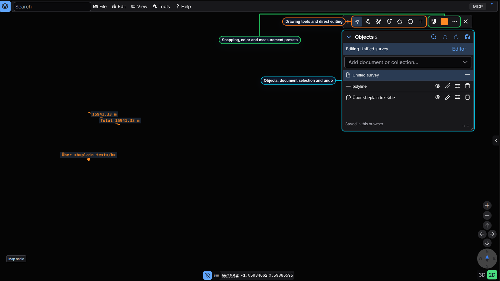

# Local drawings and measurement

Use **File → Drawing tools** to draw immediately, or **New GeoJSON** / **New coordinates** to import files. Dropping files uses the same import path. Drawings are browser-local GeoJSON datasources; their data is not uploaded to mapget or MapViewer.

The Maps accordion groups datasources under **Local** and **Remote**. A local map has an Editor button and a separate permanent-delete button. **Editing** identifies the active document in Maps, the Objects tray and the Editor. Hover and inspection do not change that editing target.

## Draw, finish, save or discard

Starting a tool reuses the active working document, or creates an unnamed draft when none is active. **Finish drawing** retains the object in the Objects tray. **New object** in Drawing options, or another tool, starts another object in the same working document. An incomplete object remains a recoverable preview; finish it or use **Clear current object** before switching tools or saving. Clear removes the current tool object, not unrelated tray objects.

**Save workspace** opens a **Name** dialog on the first save. Subsequent saves retain the current layout; **Drawing options → Save options…** changes the name or layout:

- **One unified GeoJSON document** saves the working set as one document. Combining multiple documents produces a FeatureCollection; a single document retains its existing GeoJSON root.
- **Collection · one document per object** saves one document per object in an ordered collection. Object names are editable in Quick.

Open a member in the Editor, then choose **Objects tray** to open the whole collection. **Add document** includes another local document in the working set. Repacking validates all output before committing one browser record. Unrelated saved documents remain available. Renaming does not change identity, and duplicate names do not overwrite other drawings.

Save establishes a browser-local baseline. **Export** in the Editor downloads a separate GeoJSON file without marking changes saved. Separate collection exports include versioned `erdblick:collection` membership; selecting or dropping several exported files groups the available members. Missing members are reported and never fetched automatically. Imported copies receive new local identities.

Closing with changes offers **Save…**, **Discard**, or **Keep drawing**. Editor Save commits only that document, including when it belongs to a collection. Discard removes a new draft and its recovery copy, or restores an existing saved document's baseline. Permanent deletion is a separate Maps action. Collapsing the tray preserves work.

Draft recovery is automatic, including invalid raw text and incomplete tool controls. Recovered unsaved documents reopen in the tray. Save and recovery are distinct: recovery does not establish the version used by Discard. Browser copies belong to the current origin and browser profile; clearing site data removes them. Storage failure retains live work and the prior stored revision. The shared message offers **Retry browser save**; the Editor also permits exporting valid data or copying raw text. Stale-tab detection is best effort because localStorage has no compare-and-swap transaction.

## Toolbar and Objects tray

The toolbar and tray default to the owning view's **top-right**, clear of navigation controls and the map scale. **Dock at top-right** restores that placement. Drag the dotted grip to undock; Alt + arrow keys move it, with Shift for larger steps. Dragging near the top-right shows a dock outline; releasing docks the group. Arrow/Home/End navigation moves focus within the tool strip. Resize the tray by its corner or the **Resize ↔ ↕** button's arrow keys; **Compact tray** and **Large tray** provide click-only size presets. In a short view, the tray body scrolls while Save and its footer remain reachable. Placement and size are local preferences, excluded from shared snapshots and URLs.

The tray windows the objects of every working document, grouped in file order. Optional Find searches names and geometry types, retaining at most 100 matches from the first 10,000 objects and showing when the search is limited. Each row supports selection, visibility, direct editing, Properties and undoable deletion. Double-click opens the shared Quick inspector. Hover or keyboard focus highlights that object. **Editing** selects the document targeted by Undo/Redo and Editor. Generated measurements and handles are decorations of their parent object, not additional rows.



| Tool | Interaction |
| --- | --- |
| Select / edit | Pick local geometry or use a tray row’s pencil to expose vertex handles. |
| Polyline | Click a path with measurements initially off. |
| Distance | Click positions; segment and total distances are enabled on a polyline. |
| Area | Click at least three corners; area and perimeter are enabled on a polygon. |
| Angle | Click the first arm, vertex and second arm; angles are enabled on a polyline. |
| Pen | Drag a freehand polyline; release finishes the stroke. |
| Point | Place a point; New object starts the next object. |
| Polygon | Click at least three corners; the ring closes automatically. Finish drawing stops placement. |
| Ellipse | Click its center and a diagonal radius handle. |
| Text annotation | Click its position, then type in the focused text field. Text is previewed before Place annotation; Escape cancels it. Unicode and markup characters remain text. |

**Backspace / Undo point** removes the last tool position. **Escape / Finish drawing** stops placement without committing the cursor. **Resume drawing** resumes compatible input. Text inputs, CodeMirror and modal dialogs retain their own keys. ColorPicker and Drawing options handle Escape locally.

Enable **Snap to geometry** to snap to visible native points/vertices and line segments. Options independently enable points and segments and set a 2–30 CSS-pixel tolerance. Candidates come from installed subsets without datasource requests. Text, decorations, previews, the dragged vertex and its incident segments are excluded; other vertices of the same object remain eligible. A marker identifies the target. **Shift** constrains angles to 45° increments; compatible geometry candidates can still snap. Off-plane targets are declined unless **Project off-plane snap targets** is explicitly enabled. Projected snaps show the original and projected target, a connecting guide, and the physical displacement in meters.

Select an object in Quick, then **Edit in view** to expose its vertices and cubic control handles. Dragging commits one undo step; Escape cancels the gesture. To move without dragging, click a handle, choose **Drawing options → Move selected vertex**, and click its destination. **Delete selected vertex** uses native minimum-size/closure validation; Delete on the map applies only to the selected handle, while text fields retain their own keys. The duplicated endpoint of a closed ring is one editable vertex. The Quick coordinate tree also inserts and deletes vertices with native validation. Select a segment in the map or control-vertex tree to add/remove its curve handles. Native insertion splits and reindexes controls; a geographic split that cannot meet the 1 cm sampled-shape qualification is rejected with an explicit conversion alternative. Deleting a vertex removes adjoining curve controls and reindexes the others.

## 2D, 3D, curves and measurements

A drawing session captures a view and an authoring space. **2D tools require a 2D view; 3D tools require a 3D view.** Projection changes pause incompatible input, including synchronized changes. Closing the view retains work; explicitly rebind to a compatible view to continue. Existing objects keep their space and height. First-person mode supports navigation; numeric, source and MCP edits remain available there, but pointer drawing is unavailable.

2D authored paths follow WGS84 ellipsoidal geodesics. Distance ignores altitude; angles use the local path tangents, including curve tangents. 2D polygon area is the smaller ellipsoidal area, subtracting holes. Invalid or self-intersecting rings have no reported area. Imported ordinary GeoJSON retains its coordinate-linear segments, longitude span and heights. Length, tangents and polygon boundary integration use those same segments. Quick requires an explicit 2D or 3D choice before interactive editing or measurement settings; 2D ignores retained heights, while 3D requires an explicit missing-height assignment when needed.

3D paths retain ellipsoidal height in meters and measure the lifted path through physical ECEF space. A vertical path therefore has nonzero length. These are not terrain-following measurements. 3D polygons and ellipses require an explicit physical plane. Choose **Horizontal plane · one anchor** or **Three-anchor plane** in Drawing options, then follow the anchor prompts. Subsequent pointer positions use that plane. When editing an existing 3D object, the plane is stored on that object without moving its coordinates. Native edits must lie within 1 cm of it; supplied controls are never silently projected. Polygon area is measured in the stored physical plane. Ordinary 3D polygons need a valid plane and coplanar vertices for area; otherwise area is explicitly unavailable. Arbitrary non-planar polygons are preserved.

In Quick, enable distances and angles independently for polylines; area and perimeter independently for polygons. The measurement tools are presets for these same objects and evaluator. Labels, interval markers and styling remain attached to the parent object's pick identity. The object's color drives its measurements; there is no separate built-in measurement color option. Existing explicit imported colors and custom styles remain usable.

**Add curve handles** adds a cubic segment to a polyline. Its two handles can be edited numerically or dragged. Curves use geodesic interpolation with retained height; a selected plane uses planar interpolation. The native evaluator supplies sampled geometry, length and marker positions together. Export retains controls in `erdblick:drawing` plus sampled standard GeoJSON; other viewers can display the sampled geometry. Changing units does not change samples or physical metrics. Very near antipodal control spans require another anchor.

**Interval markers** store a positive meter interval; Quick displays and edits it in the object’s selected units. Choose points or oriented line ticks. Chainage restarts for each multipart path, with labels at qualifying fifth markers. Camera-dependent thinning selects at most 1,000 markers across the visible path, including distant visible portions; the saved interval and physical measurements remain unchanged. Curves, heights and markers share one evaluated path.

Units are `meters` or `miles` (`state.measurementUnit`); one mile is 1,609.344 meters. Area labels use m² or mi². The per-view **Map scale** toggle shows a horizontal ground reference near the bottom-left, calculated from the actual camera projection. Altitude, latitude, pitch and resize affect it. It uses the current measurement units, is hidden when ground projection is unavailable, and does not describe terrain or the scale everywhere in a pitched view.

## Polar coordinates

Valid input through **±90°** is preserved, exported and measured, including pole-enclosing polygons. Both map modes currently use Web Mercator, whose viewing latitude ends at approximately ±85.05113°. Polar points and unprojectable polygon fills are omitted; visible portions of lines remain available. A viewing-limit message explains this. Fit/Center uses the visible latitude range and explains partial visibility; a wholly unviewable extent is reported as unavailable. There is no coordinate clamping or substitute fill across the map. Numeric, Quick and source edits remain available.

## Quick and Advanced GeoJSON editing

The Editor starts in **Quick**, with paged object rows, a typed inspector, and native branch reads for expanded geometry, coordinate and property fields. Each branch retains one bounded page rather than accumulating all earlier pages. Exact numeric leaf text avoids rounding large integers. Arrow keys navigate the tree; Enter expands a branch or focuses its value, and Escape restores an unfinished value. Vertex actions and page buttons remain reachable by Tab. Expanded branches retain their current page across unrelated edits. **Value options** exposes deliberate property type changes, addition/removal of object members, and array append/removal; these operations use the same native validation and undo history. The object color picker and hex field use **Apply color** for one undoable change. **Advanced** is the complete CodeMirror source. Both share Undo/Redo with toolbar changes, dragging, deletion and MCP batches. A completed drag or native edit batch is one history step; collection saving is a separate persistence boundary.

Invalid raw text keeps the last accepted model visible and blocks structured edits and Save/Export. If raw edits alter sampled coordinates independently of retained authoring controls, validation reports the mismatch. Update the authoring controls, or choose **Use edited geometry as ordinary objects** to keep the edited geometry explicitly. Conversion preserves unrelated fields and large integer IDs. Unknown authoring versions leave ordinary standard geometry usable.

GeoJSON accepts FeatureCollection, Feature and geometry roots, multipart objects, holes, nested GeometryCollections, empty/null geometry and null properties. Positions contain two or three numbers; altitude is meters. Legacy CRS declarations are rejected. The first structured edit adds stable `erdblick:object` identities, retaining the prior native identities for undo and worker recovery. Source text and native leaf edits preserve foreign members and integer IDs without passing the complete document through JavaScript number parsing. Properties such as `layer`, `typeId` and `$mapgetRelation` remain inert data.

## Coordinate import

Use UTF-8, one entry per nonblank line:

```text
11.575 48.137 520 "Entrance"
11.576 48.138 "Height defaults to zero"
11.577 48.139 -25 Description with spaces
```

Longitude (X) and latitude (Y) are WGS84 degrees. Optional height is **centimeters**. Separate fields with spaces or tabs; the remainder is the description. Use JSON string quotes for empty, numeric-leading or escaped descriptions. Import creates GeoJSON Points with meter heights and `properties.description`; the filename becomes `.geojson`. Original coordinate-text formatting is not retained.

## Actions and integration

The same domain operations are exposed as `viewer_drawing_list`, `viewer_drawing_objects`, `viewer_drawing_branch`, `viewer_drawing_read`, `viewer_drawing_edit`, `viewer_drawing_workspace`, `viewer_drawing_history`, `viewer_drawing_tool`, `viewer_drawing_presentation` and `viewer_drawing_transfer`. The catalog describes exact schemas. Remote MCP targets a registered browser viewer; document WebMCP dispatches the same declarations. New/open drawing choices also appear in the omnibar.

Read objects to obtain their native revision before editing. Read `viewer_drawing_list` for the current workspace identity, membership and accepted/raw member revisions; workspace Save, Discard, Close, Open and Select require that captured target. History requires an explicit document and accepted revision; rename/delete also require its raw draft revision. A batch is atomic within a document; stale revisions are rejected. Object reads are paged with a row `nextOffset`; source reads return bounded chunks with `nextOffset` in UTF-16 code units. Continue at the returned offset with the same revision. `portable: true` includes collection metadata. Large imports/replacements use begin/append/commit/cancel/status transfers with ordered UTF-16 offsets and complete Unicode scalar boundaries. Staging permits four slots, at most 32 MiB of UTF-8 per document and 64 MiB in aggregate, expiring after five minutes. Chunk frames are bounded below the relay’s 64 KiB request limit; results retain the 256 KiB limit. No browser file picker is required for these operations. Errors have structured codes/reasons. Native prepare/commit separates validation from publication. Cancellation or a stale raw revision before commit cancels the prepared candidate; after commit, the response reports the applied result when known. Cancellation of a committing transfer waits for that outcome. An unknown transport outcome requires rereading state before retrying.

## Implementation and limits

`drawing-shape.cpp` owns shape evaluation, physical-plane conversion, geodesic curves, measurements and derived decorations; `drawing.cpp` owns accepted objects and revision-checked edits. Authoring metadata version 1 is an additive `erdblick:drawing` foreign member. One native feature represents one object. Derived attributes use `DrawingDecorations/Decoration` with point or line validity. The bundled Drawing style targets layer `Drawing`; properties remain under `attributes.user`.

`DrawingDocumentsService` owns draft/baseline validation, working-set membership and the shared Editor history. Committed operations run in a worker. The coalesced cursor/drag preview has a separate small UI-WASM owner and reserved render worker. Deck owns pointer projection and bounded native-geometry picking. Native `snapGeometry` reads a still-installed subset, not stylized offsets or triangulation edges.

Standalone storage remains schema version 2 (`drawingDocumentData:<mapId>`). Saved collections use one atomic schema-version-1 `drawingCollectionData:<id>` envelope with explicit member order and ownership. Restoration prioritizes committed collection ownership over leftover standalone records. Recovery writes are debounced; collection envelopes are bounded to 32 MiB. Undo history is session-only. Local IDs and contents are excluded from URLs/application snapshots, and local misses never fall back to the server.

Native limits are 32 MiB UTF-8 per file, 100,000 features, 1,000,000 geometry vertices and JSON depth 64. Authored objects accept up to 10,000 controls. Adaptive curve/3D sampling uses a 1 km maximum chord, 2 cm midpoint deviation and bounded length integration, with depth 24 and one million samples; exceeding the budget gives a diagnostic. Interactive editing reads controls separately from authored sample geometry, limited to 10,000 handles and 1 MiB per handle response; oversized objects remain editable through paged Quick or Advanced. Snapping checks up to 32 rendered picks, 20,000 vertices per candidate and 40,000 per pointer lookup; dense omissions are reported. These bounds affect interaction/display, not source preservation. Terrain-following measurements, full polar rendering, topology repair and advanced curve smoothing are outside this workflow.

Area validation is bounded to 8,192 vertices per polygon, including holes. Larger polygons remain editable and exportable; Quick reports that area is unavailable instead of presenting an unchecked result.
