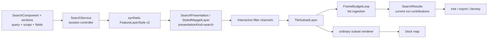

# Erdblick Search Architecture

Feature search is a specialization of the same styled-subset pipeline used by
normal map rendering. There is no `/search` endpoint, search-result tile
class, search-specific renderer, or complete-tile cache.

## Responsibilities

Erdblick owns:

- editor drafts, saved sessions, completion, and schema analysis;
- synthetic search stylesheet generation;
- result-list ingestion, grouping, density overlays, export, and UI state;
- category/gradient palette choices;
- the search presentation lifetime.

Mapget owns:

- complete source-tile loading/cache;
- schema-aware SIMFIL compilation and evaluation;
- feature/attribute candidate expansion;
- validity geometry;
- projected values, traces, and issues;
- immutable `TileSubsetLayer` output.

### Runtime and UI owners

| Owner | Lifetime and responsibilities |
| --- | --- |
| `SearchService` | Application controller: create/clone/close, reconcile saved definitions, resolve coverage, coordinate views, decode native result values, and bind actions/controls. |
| `FeatureSearchSchemaService` | Schema analysis and completion worker lanes, owner-specific completion states, timers, serials and cancellation. Workers start on demand; catalog-only construction performs no worker IO. |
| `SearchResults` (`search-results.model.ts`) | One session's contributions, append/rebuild cursor, progress, result points/buckets, density index and pure summary aggregation. Accepts only the current run and rejects work after destruction. |
| `SearchPresentation` (`search-visualization.presentation.ts`) | One search/layer's compiled style, `StyledMapgetLayer` subscription, coverage, object discovery and expiry. Replacement disposes its subscription and native style; late discovery is ignored. |
| `search-session.model.ts` | Public value contracts. Type-only consumers do not import the controller; `session.results` exposes result/progress values without the owner's mutation API. |

`SearchResults` has no Angular, DOM, map-controller or WASM dependency. The
controller supplies a density adapter through a narrow contribution/projection
interface and performs native decoding before adding contributions. The existing
frame-budgeted ingress loop remains in the controller; tasks check the session
run, presentation, tile generation and value version before accepting data.
Replacements/removals coalesce derived-array rebuilding. Native summary extraction
remains in the controller, while normalization, histogram limits and merging live
with the results.

`SearchComponent` is the dialog/dock shell: session selection, query editing,
header actions, close confirmation and export requests. Its local children own:

- `SearchResultsComponent`: PrimeNG tree, grouping/expansion, append cursor,
  animation frames and resize observer. Appends retain the 1,000-entry/8 ms budget
  and cancel when the child is removed, including docking transitions.
- `SearchScopeComponent`: map/layer selection, inferred scope and type/level/view
  drafts. It commits semantic edits through the existing search controller.
- `SearchVisualizationComponent`: rule drafts, asynchronous field metadata,
  automatic initialization, rendering choices, and apply/save. It reuses the
  shared rule/color editors and stylesheet converter.
- `SearchDiagnosticsComponent`: progress and diagnostics presentation, histogram
  labels and lazy summary requests. It does not compute summaries itself.

Children receive an explicit session ID and current values; they do not receive
the parent component or mutate runtime sessions. Timers, drafts and expanded nodes
stay local, while persisted definitions remain in `SearchState`. Scope/style
inputs track definition/schema changes independently of streamed result progress,
so each chunk does not rebuild the selectors or overwrite style drafts.

## End-to-end flow



`SearchService` owns the collection of shared search presentations, with one
resource owner per session/layer. Every consuming view attaches that presentation
to its own controller/render scene; it does not create another backend request.

## Query and scope

The user chooses feature, attribute, or auto scope.

- Feature scope evaluates once per admitted feature.
- Attribute scope expands attribute entries and validity contexts.
- Auto scope runs `LayerSchema::normalizeSearchQuery()` and is normalized to a
  concrete scope before the result channel is constructed.

Schema analysis normalizes the search query before runtime style compilation.
Outgoing render and result channels therefore use `rewrite: false`; every
filter and projected field is still schema-compiled by mapget.

Confirmed shorthand first goes through `LayerSchema::searchInterpretations`.
Each choice carries an ordinary, editable `expression` and source-local
execution plans. Choosing it replaces the session query with that expression
and clears the temporary interpretation ID. Adding maps or changing result
scope prepares that same text again; it does not re-resolve the old shorthand.
For example, a warning-sign choice becomes `**.warningSign == "SPEED_LIMIT"`
regardless of the schema hash or versioned name of the enum that suggested it.

Automatic selection of a unique attribute preserves its original shorthand.
For example, `SPEED_LIMIT_METRIC` stays in the editor while the attribute-root
plan executes `$name == "SPEED_LIMIT_METRIC"`. New scope selections recheck
that shorthand for ambiguity. Disabled searches skip preparation; their tabs
remain accessible with a static disabled status, even without a prepared plan.

Each plan's `query` evaluates the expression at its concrete feature or
attribute root. Explicit feature-root attribute paths may need rebasing, while
recursive field predicates remain unchanged. Inferred owners drive initial
styling, not persistent query restrictions. Map/layer routing and explicit
feature-type selection belong to the request; exact schema IDs only validate
the temporary plan. Standalone stylesheet export adds source guards because
it no longer has the search's map selector.

Completion origins describe where a suggestion was found; they do not define
where the accepted expression can run. Omnibar submission starts with active
layers, falling back to completion origins only when no layers are active.
Completion within an existing search preserves its explicit source selection.

Style discovery receives all prepared attribute owners together through
`preparedContexts`. Native discovery visits those exact owners without
normalizing the predicate again and shares its compact field/type tables across
sources. One worker request installs the selected schema set once, avoiding
per-owner installation and repeated metadata transfers. The cache depends on
the selected schemas and owners, so another predicate over the same owners can
reuse that inventory. Feature inventories are likewise independent of predicates;
unresolved attribute expressions still use ordinary native normalization.

The Visualization tab creates its editor on first opening. Collapsed rules retain
their drafts but release their controls. This keeps large enum palettes out of
the DOM during preparation and while viewing results; OnPush change detection
alone would still pay the cost of constructing all those hidden controls.

Recursive paths such as `**.numLanes.normalLanes` participate in Auto scope
inference through SIMFIL's schema-path analysis. If the schema also exposes a
matching basic feature property, Auto remains feature-scoped rather than
discarding those matches.

Attribute evaluation exposes:

- `$feature`;
- `$layer`, `$name`, and `$attributeIndex`;
- `$hasValidity`;
- `$validityIndex` and `$validityCount`.

The explicit bit matters because "no validity" and "first validity" would
otherwise both appear as index zero/count one.

## Synthetic stylesheet

`feature-search-style.adapter.ts` translates the session's GUI rules into flat
top-level rules. The concrete search scope is applied only to this transient
runtime source; it is not written into a reusable stylesheet. Labels,
category/gradient expressions, and geometry choices use the same native style
properties as bundled styles.

The result-only channel requests selected style fields even while their color
scales have no stops. Each received contribution retains that channel's ordinal:
both list ingestion and Diagnostics/Values summaries use it, never a hard-coded
rendering channel. This lets **Update from data** initialize numeric categories
without requiring either a schema enum or a working color scale first.
Retiring a presentation also retires its filter-progress entries, so a style
replacement cannot leave the session waiting for chunks from an obsolete filter.

The ordinary planner produces one render channel per top-level rule. Erdblick
preserves those channel IDs and native predicates, intersects their feature
types with the search selection, and combines the normalized backend query
with each channel's entry predicate. It then appends one dedicated
`search-results:<presentation>` channel containing the result-list fields.
The subset renderer deliberately skips that reserved channel, while
`SearchService` reads only its stored ordinal. Results therefore enter
the list once even when several rendering rules match them.

### Color mapping

Search categories use:

```yaml
color-scale:
  mode: categorical
  expression: "<category expression>"
  stops:
    - [value-a, "#..."]
    - [value-b, "#..."]
  fallback: gray
```

Numeric gradients use `mode: linear` and strictly increasing numeric keys.
Stops are list pairs, not a YAML map, so boolean/numeric/string key types
survive parsing. Typed categorical keys are distinct.

Multiple GUI rows remain multiple flat rules. `all-of` and `first-of` are
reserved for styles that genuinely need native branch semantics; the search
writer does not introduce them as a transport wrapper.

## Reusable search styles

A reusable search style has one authoritative representation: an ordinary
imported YAML stylesheet with `category: search`. Its exact YAML `name` is the
style identity and may contain slashes for existing tree grouping. There is no
parallel configuration ID/revision store or generated YAML cache.

`search-style-sheet.converter.ts` emits deterministic version-2 source with
the save dialog's checked-by-default enable choice as Boolean root `default`,
optional exact layer-ID affinity, one `showSearchStyle` Boolean option whose
display label is `Show <stylesheet name>` and which defaults on, and flat rules
gated by that option. Empty affinity omits `layer`
and means any layer. It deliberately
excludes query, search scope, map identity, views, feature-type selection,
density controls, UI row IDs, and automatic-rule metadata. The normal imported-style lifecycle parses,
persists, lists, edits, renders, and exports that source. Imported persistence
stores only a versioned list of raw YAML sources; no legacy search-style store
is read.

The reverse codec parses the authoritative YAML into the shared Quick rule
GUI. AST-based Quick edits preserve comments, root metadata, unsupported keys,
and untouched rules. Ambiguous branch/dynamic rules remain read-only and are
reported as warnings. Feature Search uses the same projection permissively:
compatible rules are deep-copied, incompatible rules are omitted with visible
reasons, and the YAML source is never changed. The generated option gate is
removed from Quick/detached rule data and restored on Quick writes, including
new rules. Detached reuse copies rules only; stylesheet `default`, `layer`, and
option state continue to govern normal rendering.

The save dialog emits an action-bearing immutable request. Both **Save** and
**Save and Open** import through the same transactional style lifecycle and use
the checkbox value for both YAML `default` and initial runtime visibility.
Only after a successful import and dialog close does the latter dispatch the
ordinary style-editor request; editor refusal due to another dirty session does
not roll back a completed save.

## Result identity

Each search session owns a stable presentation instance ID. Definition,
coverage, query, projected fields, or style changes replace the filter and
increment generation.

The accepted transport identity is:

```text
filterId + generation + output MapTileKey
```

There is no content/request fingerprint. Stale subset frames, status updates,
render results, and ingestion tasks are ignored when their generation no
longer matches.

## Result ingestion

A delivered `TileSubsetLayer` serves two consumers:

1. `TileSubsetLayerVisualization` renders it through the global finite worker
   service.
2. `SearchService` extracts typed entries into result-list records.

List extraction is scheduled through `FrameBudgetLoop` so a large result tile
cannot monopolize the browser thread. Tasks are generation-aware and
cancellable. The frame loop is a utility, not an owner of search or map
objects.

Entry values follow the channel field schema. Scalar projection behavior is:

- no result -> null;
- first result wins;
- later results are ignored.

Structured projection values are not a hidden full-feature transport. Search
exports and UI metadata should request explicit scalar fields.

## Geometry and map rendering

Search map results use `TileSubsetLayerRenderer`, exactly like regular styles.
Feature rows carry selected geometry; attribute-validity rows carry effective
validity geometry when available. There is no high-fidelity search renderer.

Density dots/pins/labels remain UI overlay layers derived from ingested search
records. They are not a replacement for subset geometry and do not own backend
models.

## Hover, selection, and inspection

Hovering or selecting a result passes exact canonical feature identity to the
controller. If that typed search/regular entry is still rendered, a local
interaction overlay applies the stylesheet's `interaction-effects` material
without a backend request. Only a requested validity/relation semantic absent
from every active subset creates an exact-root highlight presentation; its
output is fed through the same overlay material path.

Inspection is separate:

1. request the declared tile through feature-restricted `/tiles`;
2. canonical `/locate` if a relation endpoint belongs elsewhere;
3. retry against the owning tile;
4. release complete feature data when the panel closes.

Search result subsets never hydrate or share a complete source tile.

## Completion and schema analysis

Style-field discovery traverses installed native schema types and exports a
compact inventory. Feature properties appear only under `attributes` in the
picker; explicit queries and existing styles can still use `properties`. This is
a feature-root alias rule, not a global spelling substitution: nested fields
literally named `properties` or `attributes` retain their own metadata.

`TileLayerParser.searchStyleFieldsForQuery(query, scope, options)` accepts selected
map/layers, `selectedFeatureTypes`, an optional exact `context`, a semantic `path`,
`recursive`, and `values: "scalar" | "all"`. Path steps are field-name strings or
`{elements: true}` for array traversal. Native code resolves each step, including
all schema alternatives, and produces the corresponding Simfil expression. The
UI does not maintain a second schema graph or parse field expressions.

The response contains `contexts`, `types`, `fields`, `branches`, `complete` and
`incompleteReason`. A field holds its expression, one type-table index and all
context indices in which that meaning applies. Metadata is exported once per
exact schema/type. Native rows preserve distinct meanings; the editor offers
one choice per expression and withholds conflicting type metadata rather than
silently choosing the first owner. Automatic preparation retains each source
and attribute owner until all sources have contributed their rules. Equal
appearances then merge, and a discovery condition is removed only when doing
so admits no prepared context requiring a different appearance. Reduction
prefers attribute names over source IDs and owner layout; one conjunction
remains ordinary editable filter rows. Exact color type guards stay intact.
Mixed feature/attribute roots retain their result scope, while equal rules can
still merge across sources within that scope. Live rendering and YAML export
use the same applicability check; optional map/layer selectors retain explicit
source restrictions. Each
attribute context may supply `primaryValuePath`,
the unambiguous native scalar shorthand, so common validity/source metadata does
not displace the attribute value in automatic coloring.

Prepared attribute owners also carry `queriedPaths`, derived from native
Simfil references at the branch's actual result root. Positive comparisons
exclude paths whose declared types cannot match their literal. An explicit
predicate therefore cannot select unrelated numeric references merely because
they share a leaf name such as `value`. An empty path list uses solid styling;
absence permits the primary scalar for a whole-attribute query. Unknown
metadata remains conservative for search membership, without inventing a
color scale. These query-specific paths are separate from the cached owner
inventory, so the field picker still exposes all declared fields.

Scalar requests omit container descriptors while retaining navigable branches.
`complete` concerns declared paths in the requested subtree, not whether an open
schema lists every possible runtime field. Recursive cycles are reported and can
be explored explicitly through the native API. The rule editor requests recursive
scalar discovery without a separate branch/context UI; custom expressions and
completion remain available for deeper recursive paths. Attribute discovery uses
`LayerSchema.normalizeSearchQuery`, exactly as execution does, rather than the
broader leaf/enum inference used for layer suggestions.

Implicit discovery skips edges marked `Schema::FieldRole::Context`, including
the owner-feature overlays. Explicit lookup through `$feature`, `$source` and
`$target` remains valid. Ordinary data fields beginning with `$` are not excluded
by spelling.

The completion worker installs binary `MapSchema` artifacts and their source
metadata into parser-owned state. Installation must succeed before a query runs;
failure is explicit rather than an empty completion result. Requests are serialized
within a worker lane and checked against their selected maps' model generations
before installation and after completion. It provides:

- syntax diagnostics;
- direct/nested field completion;
- enum values, ordinary numeric ranges, named numeric specials and flag types;
- feature/attribute ownership analysis;
- candidate label/category/gradient fields.

The omnibar requests completion from all currently ready feature layers, including
hidden ones. Unavailable sources do not block suggestions from other maps.
Confirmed-search preparation still checks every explicitly selected source.

Native attribute completions retain the plain name, with any ambiguity resolved
after confirmation. Enum completions insert predicates. Whole-query completions
mark `isExactMatch` when the draft already spells
the symbol fully, before expanding it into a predicate. The editor uses that
flag to submit a complete name on Enter; partial names still accept the selected
suggestion first. TypeScript does not parse the suggested expression to recover
its original symbol.

Feature inventories are cached independently of the predicate, keyed by source
generation and discovery options. Attribute inventories also retain the query
because it selects their semantic owners. Concurrent identical requests share
one result, and the component reuses its dropdown arrays when that inventory is
unchanged. Failures never become a cached empty inventory.

Performance entries separate native enumeration and validation in the worker
from delivery, main-thread aggregation and the next animation frame:
`erdblick.search.style-fields.worker`, `.apply` and `.next-frame`. Worker detail
contains `nativeMs`, `normalizationMs` and `deliveryMs`. Delivery includes
structured cloning and queue delay; the next-frame interval is a scheduling
measurement, not a claim about rendering CPU. Use a browser trace to assess
layout/paint and retain the selected scope alongside comparative measurements.

This worker is advisory. Backend compilation remains authoritative.
`rewrite: false` still schema-compiles for correctness and speed; it merely
skips search-query normalization.

Result and trace summaries retain separate groups for each exact schema/type
pair, plus a separate unqualified group. Identical expression text does not imply
identical units or exceptional values. Named sentinels remain in raw histograms
but do not contribute to ordinary numeric ranges or averages. Trace call counts
and timings describe the whole trace and are repeated on its type cards; do not
sum those cards to obtain a total trace duration.

## Diagnostics

There are three distinct diagnostic sources:

- editor/worker syntax and schema-analysis diagnostics;
- backend `FilterIssue` aggregates and SIMFIL traces on subsets;
- transport/render/ingestion timing and failures on presentation state.

Do not fabricate a backend AST in TypeScript. If exact compiled backend
expressions become necessary, serialize that metadata in the filter result.

Source tile statistics come from inherited subset `info()` and dependencies,
deduplicated by the diagnostics service. Search-filter and renderer costs stay
presentation-specific.

## Cancellation and limits

- Re-running a session replaces its filter generation.
- Coverage follows the active search viewport policy.
- Backend loops check cancellation at feature boundaries/fixed batches.
- Frontend ingestion checks generation between batches.
- One-hop relation depth does not bound breadth; production deployments should
  cap roots, relations, target tiles, and output bytes.

## Key files

- `app/search/search.service.ts`
- `app/search/feature-search-style.adapter.ts`
- `app/search/search.component.ts`
- `app/search/search-completion.worker.ts`
- `app/utils/frame-budget-loop.util.ts`
- `app/mapdata/styled-mapget-layer.presentation.ts`
- `app/mapview/view-layer.controller.ts`
- `app/mapview/deck/tile-subset-layer.visualization.ts`
- `libs/core/src/style-filter-plan.cpp`
- `libs/core/src/subset-renderer.cpp`
