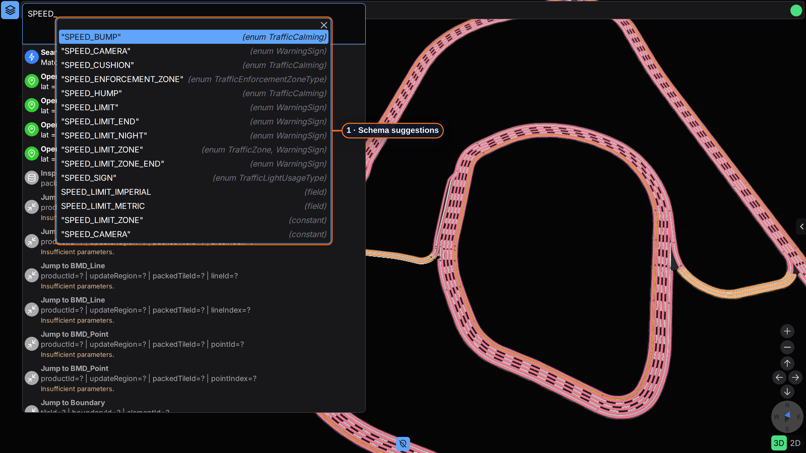
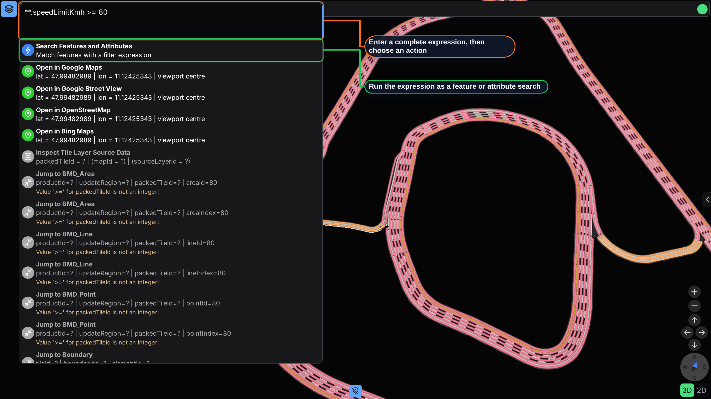

# Search Guide

Erdblick has two search surfaces:

- The palette, opened with `Ctrl+K` or the magnifier icon, starts jump targets, utility actions, and feature searches.
- A feature search opens its own persistent **Search Loaded Features** panel with results, visualization controls, and diagnostics.

## Working With the Palette

<!-- --8<-- [start:overview] -->
Erdblick's search palette unifies jump targets, utility actions, and the Simfil-based feature-search entry point. Open it with `Ctrl+K` or by clicking the magnifier icon; the textarea expands into a command palette whenever the dialog is visible.

1. **Input field** - accepts coordinates, tile IDs, feature identifiers, or Simfil expressions. The field turns multi-line while the palette is open.
2. **Autocompletion** - suggestions from ready maps appear near the caret after a short delay, including for hidden layers. An unavailable map does not block other maps' suggestions. `ArrowUp`/`ArrowDown` select a suggestion; `Tab`, `Enter`, or a click inserts it without running an action. A fully typed name can be confirmed directly with `Enter`. Attribute suggestions insert ordinary names; ambiguous names are resolved when the search is confirmed.
3. **Actions and parameters** - targets validate your input in real time. Feature search remains visible for an invalid draft, disabled with its Simfil parse error in a bubble. Feature jumps show matching type prefixes or complete valid IDs. Single-line rows use right-aligned bubbles for filters, location sources and parsed parameters; `?` marks an unspecified value, with optional parameters identified in their tooltips. Incomplete actions remain grey. Long bubble contents truncate within the panel; hover to read the full value. Narrow panels hide parameter names while retaining values.
4. **History** - executed targets are stored in browser state. Matching entries appear below active actions and can be re-run or removed individually.
5. **Execution shortcuts** - after completion is accepted or dismissed, `Enter` runs the first active target. Completed schema input puts **Search Features and Attributes** first; commands using typed input precede commands that can use the current viewport. With completion closed, `ArrowDown` enters the first action and `ArrowUp` the last action or history entry. Continue with the arrows or `Tab`/`Shift-Tab`; disabled entries are skipped, and the focused row scrolls into view. `Shift-Tab` from the first action returns to the input, and `Tab` from the last row does likewise. `Enter` executes that row. `Escape` dismisses completion first, or returns from an action to the draft. Further `Escape` presses in the input clear the draft, then close the palette. Clicking an action also executes it directly.
6. **Context hand-offs** - SourceData actions, inspection row actions, map coverage buttons, and other tools can push pre-filled queries into the palette or directly open a feature-search panel.

The palette closes automatically when you click the map or another control, but search history and partially typed queries are preserved until you clear them.

New feature searches start with the active map layers. A completion's source list
is a suggestion, not a scope restriction: it seeds the search only when no layers
are active. Accepting completion in an existing search edits its expression and
preserves its **Map Layers** selection. Explicit scopes supplied by other actions
remain authoritative.
<!-- --8<-- [end:overview] -->



Choose an action from the palette after completing the expression.



**Schema suggestions (1)** distinguish fields, enum values, and constants.
This example starts a speed-limit query with `SPEED_`.

<!-- mcp:
title: "Search palette navigation targets"
keywords: ["jump", "coordinates", "tile ID", "feature ID", "place name", "location"]
hint: "For a place name, use mapget_lookup_place to obtain candidate WGS84 coordinates and bounds; choose the intended match, then fit its observed bounds with viewer_navigate. For a point-only result use view.camera with the observed coordinates and an appropriate scale. A wof: place ID is not a map feature ID. Use mapget_get_place_geometry only when the full boundary is needed. The palette remains a UI alternative when supported by the deployment."
-->
## Built-in Jump and Utility Targets

<!-- --8<-- [start:jump-targets] -->
| Action | Input syntax | Result |
| --- | --- | --- |
| **Search Loaded Features** | Any valid Simfil expression | Opens a feature-search panel for the query. The panel streams result layers from the backend, keeps its own result tree, and can be docked, undocked, paused, refreshed, styled, bookmarked, or closed independently. |
| **Place / Location Matches** | Place-name text such as `Munich` | Available while location search is enabled. Point navigation uses a supplied centrepoint and updates the marker; with boundaries disabled, results without a usable centrepoint cannot navigate. With accepted boundaries enabled, an area result fits and briefly highlights its boundary or extent while preserving the existing marker. |
| **Mapget Tile ID** | `<tileId>` (integer without spaces) | Navigates to the requested tile by computing its bounding box. Useful for links copied from logs or SourceData tools. |
| **WGS84 Lon-Lat Coordinates** | `lon, lat` or `lon lat [level]` (decimal) / `12°34'56"W 48°01'30"N [level]` (DMS) | Positions the active view on the provided longitude/latitude pair. An optional zoom `level` snaps to the matching tile. |
| **WGS84 Lat-Lon Coordinates** | `lat, lon` or `lat lon [level]` (decimal/DMS) | Same as above but with the order reversed for users accustomed to `lat,lon` input. |
| **Open in Google Maps** | Optional WGS84 coordinates | Opens Google Maps at the supplied coordinates, or at the current marker/viewport fallback location. |
| **Open in Google Street View** | Optional WGS84 coordinates | Opens Google Street View at the supplied coordinates, or at the current marker/viewport fallback location. |
| **Open in OpenStreetMap** | Optional WGS84 coordinates | Opens OpenStreetMap at the supplied coordinates, or at the current marker/viewport fallback location. |
| **Open in Bing Maps** | Optional WGS84 coordinates | Opens Bing Maps at the supplied coordinates, or at the current marker/viewport fallback location. |
| **Inspect Tile Layer Source Data** | `<tileId> ["Map Id"] ["Source Layer"]`<br/>Quotes are optional; escape spaces with `\ ` | Opens the SourceData inspector for the chosen tile/layer. The validator checks that the map ID exists and that the layer matches a known SourceData entry. |
| **Feature ID Jump** | `FeatureType value1 value2 ...` or `FeatureType.value1.value2` | Locates a specific feature by its identifier fields, pans the active view to the match, and highlights it. Only feature types advertised by the loaded maps are offered. |

All coordinate targets accept decimal or degree-minute-second formats. When you include a zoom level, erdblick fits the containing tile rectangle while keeping the marker at the exact entered coordinate.

The four **Open in** actions use explicit coordinates when the input is a valid WGS84 pair. With ordinary text or an empty input, they use the enabled marker position if one exists, otherwise the centre of the focused viewport. They only open the external service: they do not move the erdblick camera or create a marker. Right-click a map location and use **Open in…** for the same services at that exact location.
<!-- --8<-- [end:jump-targets] -->

### Place-Name Location Search

<!-- --8<-- [start:location-search] -->
Location search is part of the same palette as coordinate jumps and feature search. Type a place name such as `Munich`, wait for the configured providers to return matches, and select the desired result from the active actions list.

Erdblick only sends name-like queries to location providers. Numeric IDs, coordinates, and mixed strings such as postal-code searches stay with the normal jump and feature-search targets. The default minimum query length is two characters.

Location results are sorted by population when the provider supplies it, then by name, provider, and stable result id. On first startup, erdblick asks whether to enable location boundaries after showing a fixed disclaimer and Who's On First attribution. Choose **Accept and enable** for area navigation, or **Keep disabled** to navigate to each result's supplied centrepoint. Closing the dialog also keeps boundaries disabled.

Manage these choices in **Edit -> Preferences -> Inspect & Search**:

- **Enable location search** controls location-provider queries and location entries in the palette, including history suggestions. Switching it off cancels pending queries and hides these entries; other search actions remain available. Switching it back on restores location search using the saved boundary preference.
- **Location boundaries** controls area navigation and temporary polygon or extent highlights across all map views. Switching it off immediately removes existing area highlights and cancels pending area navigation. Every later attempt to enable it requires acceptance again.
- **Disclaimer**, **Who's On First**, and **License** links beside both toggles remain accessible while disabled. Reading the disclaimer does not change either preference or record acceptance.

With boundaries disabled, selecting or replaying a location jumps to its supplied centrepoint and can show the normal point marker and place label. It neither requests boundary geometry nor fits an extent. A result without a usable centrepoint reports that it cannot be navigated to; it does not enable boundaries as a fallback.

These preferences and the accepted disclaimer revision are stored locally for this browser and application origin. Shared URLs, snapshots and deployment defaults cannot enable boundaries or import acceptance. An unchanged accepted decision survives reload; updated terms require fresh acceptance if boundaries were enabled. Clearing browser storage starts the initial prompt again.

With boundaries enabled, selecting a built-in Plazs result uses its available boundary, then its bounding extent, then its representative coordinate:

- A polygon fits the active map to the complete area, including islands and holes, and briefly highlights its actual shape in aqua before fading.
- An extent without a usable polygon fits and highlights a rectangle. If a requested boundary cannot be loaded, a short notice explains the fallback.
- A result without a usable area retains the coordinate jump and location marker. External location providers retain their existing point behavior.

Area navigation shows a temporary place label and preserves any existing marker. It uses the visible map pane and retains the camera orientation when a complete fit is possible. Very broad extents can zoom out beyond one world; polar areas are limited to the portion Web Mercator can display. A later selection or camera interaction cancels a pending lookup.

Boundaries are loaded only after selection with acceptance in effect. Search history stores lightweight place metadata and follows the current preferences when replayed; it does not store polygon coordinates. Provider credits and source/license links appear with the location result. When boundaries are enabled, an extent-only record is interpreted as an area even when its original source geometry type is unavailable.

Use **Location Matches** in the same preferences tab to control how many location matches the palette asks providers to return. The default is 10; the supported range is 1 to 50.
<!-- --8<-- [end:location-search] -->


**Offline place matches (1)** come from MapViewer's built-in location lookup.

### Feature Jump Targets

<!-- --8<-- [start:feature-jumps] -->
In addition to the static entries above, erdblick exposes per-feature actions based on the feature types advertised by the loaded maps:

- Start your query with a feature type prefix, for example `LaneGroup`, followed by ID values in the order shown by its parameter bubbles. Tokens may be separated by spaces, commas, dots, or semicolons.
- The palette lists matching feature types and their ID parameters. Without a type prefix, only complete valid IDs produce feature-jump entries. Empty or unrelated input does not list every feature type. Missing or invalid ID parts show `?`, and incomplete jumps remain disabled.
- If the feature type is offered by multiple maps, erdblick prompts you to pick the target map before it asks the backend to locate and highlight the feature.
- Successful jumps move the camera in the currently focused view and select the located feature.
<!-- --8<-- [end:feature-jumps] -->

## SourceData Integration

<!-- --8<-- [start:sourcedata] -->
Typing `tileId "Map" "SourceLayer"` is not the only way to reach SourceData:

- The map's right-click menu can pre-fill the last inspected tile ID and map ID into the palette. Selecting the **Inspect Tile Layer Source Data** entry reopens the inspector with the correct layer highlighted.
- When you copy tile information from the SourceData panel, it uses the same quoting rules, so you can paste the string straight into the search input.
<!-- --8<-- [end:sourcedata] -->

<!-- mcp:
keywords: [search, sessions, scope, attribute, pause, stop, viewport]
hint: "Start a visible search with viewer_start_search using explicit mapLayers, viewIds for the intended tab. MCP autoUpdate defaults to false. Keep the returned searchId; use viewer_control_search for pause/resume/stop/close/rerun/refresh. Read progress with viewer_get_search; stopping retains partial results."
-->
## Feature Search Sessions

<!-- --8<-- [start:feature-search] -->
Running **Search Loaded Features** opens a persistent feature-search session. Each session owns its query, selected map layers, selected views, streamed result set, visualization settings, diagnostics, and browser-state entry.

The backend search is an ordinary mapget `/filter` presentation. It evaluates
the selected map/layer coverage and streams immutable `TileSubsetLayer`
results. The same subset feeds styled map geometry and frame-budgeted result
list ingestion, so matches can appear while backend work and tree construction
are still in progress.

Confirm a new query with **Enter** before preparation starts. Typing only edits the draft and offers completions. Preparation resolves the query against the selected schemas, chooses its evaluation contexts, and creates its initial visualization before any backend search is sent. A spinner identifies interpretation discovery and initial visualization preparation.

If a name has several meanings, **Choose one interpretation** shows each proposed query and its applicable maps/layers. For example, `SPEED_LIMIT` can name a Classic speed-limit attribute or a Live warning-sign value. Exactly one interpretation can run. The highlighted choice step replaces progress and result tabs until you choose; scope controls remain available above it. Changing those controls recalculates the choices for the confirmed shorthand. If only one meaning remains, preparation continues automatically.

An unambiguous attribute name stays as entered: `SPEED_LIMIT_METRIC` needs no `**.` prefix. Its prepared execution plan supplies the attribute-root predicate. If you later add sources that introduce another meaning for that shorthand, preparation asks you to choose.

Choosing an interpretation writes its ordinary Simfil expression into the query editor and updates **Map Layers** to that choice's initial sources. For example, the warning-sign choice can become:

```simfil
**.warningSign == "SPEED_LIMIT" or **.movableWarningSign == "SPEED_LIMIT"
```

That expression is the saved query. It contains no schema hash, graph-local type number, or enum-version restriction. Recursive field selection accommodates wrappers such as `attributeValue.warningSign`. Numeric named values use symbolic comparisons against each field's current type; flags use `hasFlag` rather than converting their encodings to strings. A name alone and its quoted standalone spelling offer the same choices; an explicit comparison selects the addressed field directly.

After acceptance, editing **Map Layers**, feature types or result scope prepares the same expression again. Adding a map with a different schema hash or signs version does not reopen the original shorthand's ambiguity. Its data matches when it satisfies the explicit condition; a genuinely renamed field requires editing that condition. Completion can also insert an explicit expression into the draft, with preparation still waiting for **Enter**.

While a replacement is preparing, waiting for a schema, or awaiting a choice, previous results remain labeled with their previous query. Saved searches and JSON exports retain the accepted query text, not a schema-specific interpretation binding. Each temporary execution plan still records its current schema artifact so stale plans can be rejected and prepared again safely.

MCP follows the same workflow: `viewer_start_search` creates the session, `viewer_get_search.preparation` reports readiness and choices (including their proposed `query`), and `viewer_choose_search_interpretations` accepts exactly one choice. The accepted text appears in the session's `query`; all search action inputs reject combined interpretations. `searchComplete` remains false until preparation and result ingestion have completed.

Important controls:

- **Docked or floating panel** - keep a search in the Search dock, undock it into a dialog, reorder docked panels by dragging their headers, or keep several searches open side by side.
- **Enabled toggle** - disables a search without deleting it. Its query and settings remain saved, and its Visualization and Diagnostics tabs remain accessible, including after a page reload. The status reads **Search disabled**; preparation and execution resume when it is enabled again.
- **Query input** - edit the Simfil expression inline. Press `Enter` to rerun. If the text differs from the active search, the refresh action becomes **Rerun search**.
- **Map Layers** - restrict the search to selected maps and layers. This also narrows schema-aware completion and style-field pickers.
- **Scope** - choose `Auto`, `Feature`, or `Attribute`. Feature scope evaluates once per feature. Attribute scope evaluates once per attribute/validity context and exposes `$name`, `$layer`, `$feature`, `$attributeIndex`, `$hasValidity`, `$validityIndex`, and `$validityCount`. Auto chooses attribute scope when schema metadata proves that the query targets attribute-layer fields.
- **View** - in split view, choose where the result layer is visualized: left view, right view, or both. Auto-update follows the visible tiles of the selected view set.
- **Auto update area** - when enabled, panning, zooming, layer changes, and split-view changes refresh the search area automatically. When disabled, use **Update area** to replace the search area with the current visible tiles without changing the query.
- **Refresh / rerun** - refresh repeats the active search over its current area. When the query text is dirty, the same action becomes **Rerun search** and commits the edited query before searching.
- **Bookmark** - keep important searches in state and protect them from accidental close. Closing a bookmarked search prompts you to confirm, with an option to export first.
- **Pause, resume, and stop** - pause or stop long searches without closing the panel. Pausing preserves current results; stopping terminates the active backend run for that session.
<!-- --8<-- [end:feature-search] -->

<!-- mcp:
title: "Search result identities and export"
keywords: ["results", "select", "inspect", "pagination", "export", "partial"]
hint: "Read bounded result slices using viewer_get_search_results and use runId/refresh guards when iterating. It returns identities, not complete features. viewer_export_search returns bounded JSON text; it does not trigger browser downloads or export full feature GeoJSON."
-->
## Results

<!-- --8<-- [start:results] -->
The **Results** tab is built for large streamed result sets.

- **Progress** is split into backend search, result chunk ingress, and result-tree construction. A search can show matches before all progress phases are complete.
- **Grouping** lets you organize results by map, layer, feature, and tile. Counts per branch keep large sets navigable. Groups expand automatically once the search and frame-budgeted tree construction are complete; later manual collapse is preserved.
- **Filtering** appears when the tree contains results and filters matched feature rows without rerunning the backend search.
- **Selection** is a normal feature-selection entry point. Clicking a result focuses the map, opens or updates inspection, and highlights the matched feature.
- **Attribute-scope selection** can focus a specific attribute/validity target instead of only the owning feature. When validity geometry is available, the map highlight follows that validity.
- **Hovering** a result previews the matching feature or attribute target without changing the selected inspection.
- **Export as JSON** writes the search configuration and/or result data for offline analysis. Exports preserve enough map/layer/result metadata to reopen the investigation context and are useful before closing a bookmarked search. Treat the exact JSON fields as an integration format, not as a hand-edited user format.
<!-- --8<-- [end:results] -->


The query `**.speedLimitKmh >= 80` finds lane speed-limit attributes.
**Search scope** restricts the dataset and evaluation scope;
**Matching lanes** lists concrete results ready for inspection.

## Result Visualization

<!-- --8<-- [start:visualization] -->
The **Visualization** tab controls how one search session is drawn on the map. Its high-fidelity rules can also be saved as ordinary reusable YAML stylesheets.

<!-- mcp:
title: "Search result density map"
keywords: ["density", "heatmap", "heat gradient", "bucket", "count", "marker size"]
hint: "Read viewer_get_search and send changed settings with viewer_set_search; omitted settings and renderStrategy fields are preserved. Density controls live under renderStrategy: showLowFiDots, showBucketLabels, densityHeatGradient and densitySizeMultiplier; pinColor controls the base color. Density aggregates search matches, not an arbitrary continuous attribute surface."
-->
### Result Density Map

The density map is the safe overview for broad searches. It aggregates matches into visible tile buckets and draws colored markers.

- Toggle density markers on or off.
- Pick the density/pin color for the search session.
- Show or hide density labels.
- Enable a heat-gradient mode for denser buckets.
- Adjust marker size with the multiplier slider.

![Animal-warning search results shown as a configurable density map][search-density]

The query `**.warningSign == "ANIMALS"` finds animal-warning attributes across
the road network. **Density Labels** show compact counts for tile aggregates
(such as `5+` or `20+`). **Gradient** gives higher-count visible markers warmer
colors, and **Marker Size** scales the markers.

<!-- mcp:
title: "Detailed search result geometry"
keywords: ["high fidelity", "high-fi", "geometry", "validity", "pins", "visible tiles"]
hint: "In viewer_set_search settings.renderStrategy, showHighFiGeometry enables detailed geometry; highFidelityMaxVisibleTiles gates it by a tilt-independent camera-scale tile count, as for ordinary map styles. Preserve density settings for a broad-view fallback. Search help for \"Style Rules\" to configure colors and labels."
-->
### High-fi Visualization

High-fi visualization draws styled result geometry when the camera is close enough for detailed rendering. The cutoff uses the same canonical, top-down camera-scale tile count as ordinary map styles. Tilting toward the horizon does not hide nearby results or abruptly coarsen their density markers. The search still requests tiles in the actual viewport footprint.

- Toggle styled result geometry on or off.
- Enable per-feature result pins when high-fi geometry is active.
- The default high-fidelity cutoff is 512 tiles at the canonical camera scale. Zooming out beyond that limit switches to density markers.
- Attribute-scope results use computed validity geometry where available; attributes without validities use feature display geometry. A failed validity computation can produce empty geometry rather than a whole-feature fallback.

<!-- mcp:
keywords: [search styling, visualization, rules]
hint: "Read viewer_get_search, modify its searchStyleRules array while retaining unrelated rules, then send that array with viewer_set_search; other settings are preserved. GUI rule geometry is an array, and its color object differs from YAML color-scale syntax. Search help for \"Style typed color scales\" only when authoring ordinary YAML styles."
-->
### Style Rules

Search style rules are evaluated only for the result layer of the current search.

- **Add Rule** creates another rule. Reset restores a rule to its generated defaults; delete removes it. Rule names are only local labels for keeping several result styles readable.
- Rule headers show compact summaries for geometry, filters, color mode, and preview colors.
- **Filter** conditions can use schema-backed field pickers, comparison operators, numeric inputs, enum value pickers, text values, or custom Simfil expressions. Multiple conditions inside one rule are combined for that rule.
- **Geom** chooses one or more rendered geometry groups. **Any geometry** and **Label** are exclusive modes; line, surface, polygon, mesh, and point groups can be combined. Geometry rules expose the relevant width, point diameter, label size, and opacity controls for the selection.
- Automatic styles use a 20 px point rule and a 5 px combined line/surface rule so both geometry families remain legible without duplicating every concrete surface type.
- Search widths, point diameters, pins and label sizes are screen pixels: zoom and camera tilt change their placement, not their apparent size. Saved search styles retain this billboard behavior.
- **Labels** can use a selected field or a custom label expression. Common labels are speed-limit values, feature types, validation rule IDs, and issue IDs.
- **Color** supports solid colors, numeric gradients, and categories for numeric, boolean, or string values. Schema enums can initialize categories immediately; other fields use **Update from data** or manually entered values. In category and gradient modes, **Fallback color** controls how missing or unmatched values are drawn. Uncheck it to omit those values from rendering; the setting survives saving and reopening the stylesheet. Incomplete scales still use a temporary solid colour until valid stops are supplied. **Update from data** uses the Diagnostics/Values summaries from the current result set, collected from the result-only channel independently of rendering rules, including when a category scale has no stops yet.

Initial automatic rules use schema-declared primary values or fields identified by the chosen meaning. Owners and source layers sharing the same field, compatible value meaning and appearance share one point rule and one line/surface rule. Numeric types must agree on units, ranges and special values. Symbolic enum catalogs combine their labels, even when a newer version adds entries or changes wire ordinals; equal labels keep equal colors. Different field paths or incompatible numeric meanings retain their own guarded rules. If no value field can be selected confidently, they use the search color. Receiving results or opening the Visualization tab does not change the selected field or color mode. Manual edits remain authoritative when a new query is confirmed.

For example, a query matching both `movableWarningSign` and `warningSign` needs
four initial rules: two field paths, each with point and line/surface styling.
Adding a map with another compatible warning-sign catalog extends those rules'
accepted types and category labels rather than duplicating the rules.

Generated rule filters distinguish appearances within the selected search. For
example, Road and Lane warning signs can share a rule filtered only by
`$name == "MOVABLE_WARNING_SIGN"`; the search already supplies their map/layer
coverage. If every matching context uses one appearance, no extra rule filter
is needed. Feature, attribute-layer or map conditions remain when they actually
separate different fields, scales or solid fallbacks. A color's exact type guard
is preserved: on a mismatch it can still draw the fallback color, so it does not
replace the rule's applicability conditions.

Field choices follow the search's selected maps, layers and feature types. For
attribute searches, they use the same resolved attribute owners as query execution.
Each expression appears once, even when several owners expose it. Automatic rules
prefer a field explicitly addressed by the query, then the attribute's native
scalar shorthand (for example, the speed value rather than validity direction).

Feature properties appear once, under `attributes`. Existing expressions using
`properties` remain valid. Nested array fields use expressions such as
`attributes.samples.*.reading`. Such an expression can return several values: a
color or label still needs one result, so use an explicit index or a suitable
aggregation when necessary. Recursive schema cycles are not expanded indefinitely;
use the custom expression input and completion for paths beyond a cycle.

Numeric domains keep ordinary values separate from named exceptions. For example,
a speed type can define `254` as variable and `255` as unlimited; these receive
editable special colors instead of stretching a gradient. The schema determines
whether zero is ordinary or exceptional. Unit labels and round gradient steps use
the type's scale and offset, while saved stops retain the original numeric
encoding. A computed plain number does not inherit units or exceptions merely
because its expression mentions a typed field.

Generated scales remember the exact schema/type they describe. When that meaning
changes, the editor offers **Use current schema** explicitly; saved colors are not
silently rebound to reused numeric IDs. **Update from data** requires one observed
domain. Narrow the map/layer scope when Diagnostics shows several incompatible
meanings. Bitmask fields offer named `hasFlag(...)` choices with boolean colors;
they do not generate a category for every observed combination of bits.

![Search visualization rule and its rendered result][search-visualization]

<!-- mcp:
title: "Save and reuse search styles"
keywords: ["save style", "reuse", "search category", "detached", "export"]
hint: "The Save/Saved styles controls are normal UI actions; no semantic save-search-style command is exposed. viewer_edit_style can create browser-local YAML directly when its semantics are known. A saved stylesheet captures resolved scope, normalized query, and selected feature types in ordinary rule predicates."
-->
### Re-using Search Styles

Use **Save** beside the high-fidelity controls to create a canonical stylesheet. The small save dialog accepts the exact stylesheet name, optional layer affinity, and a checked-by-default **Enable this style upon save** checkbox. Slashes in the name create the same groups used by the normal Styles tree. Empty affinity means any feature layer; selected layer IDs are stored as an escaped exact-match `layer` expression and apply to every map that uses that ID. **Save** creates the style and closes the dialog; **Save and Open** creates it and then opens the ordinary Style Editor. **Cancel** creates nothing. Saving is create-only: an empty rule list or a name/URL collision is rejected without overwriting anything. The generated source has `category: search`, `version: 2`, a root `default` matching the checkbox, one per-layer **Show &lt;stylesheet name&gt;** Boolean option that defaults on, and one flat top-level YAML rule per GUI rule. Every generated rule is gated by that option. The imported style's initial global visible state matches the save checkbox; once active, its per-layer option is available in Maps & Layers.

The dialog captures the resolved feature/attribute scope, normalized query, selected feature types, and visual rules when opened. Saving before scope resolution completes reports a message instead of guessing feature scope. Generated rules retain the query and feature-type restrictions, so the imported style independently matches the search. Attribute styles render matched validity geometry where available; attributes without validities use their feature geometry. Selected layer IDs initialize the affinity picker. Export adds source guards to preserve the selected maps/layers in the standalone stylesheet; live per-map queries do not need those guards. Result views, tiles, and density controls remain outside it. The saved YAML is registered immediately as a normal browser-imported style and appears under **Edit -> Styles Configurator -> Styles** with a **Search** tag.

![Save Search Style dialog][10-save-search-style]

The saved sheet also provides a per-layer visibility option in **Maps & Layers**:

![Saved search stylesheet and its Maps & Layers option][11a-saved-search-style-editor]

The adjacent **Saved styles** menu lists loaded stylesheets whose category is `search`. Selecting one projects every compatible rule into the current GUI as a detached copy. Root `default`, `layer`, and the generated per-layer visibility option govern ordinary stylesheet rendering; they do not alter the active search scope when rules are copied here. The converter removes its generated option gate from the detached rule copy, retaining captured predicates so they intersect with the new search. Rules with an explicit incompatible scope are omitted; older generic templates remain supported. Editing that copy does not change the stylesheet, and later stylesheet edits do not change the search. A partially compatible stylesheet remains selectable and reports every rule omitted from the copy. A stylesheet with no compatible rules is shown in red and disabled.

![Saved Lane Speed Search sheet applied as a detached visualization rule][11b-saved-search-style-reuse]

Edit a saved stylesheet from the ordinary Styles tree. The Style Editor opens on **Quick**, with common native controls visible and advanced fields in expandable groups. It supports nested rules, exact geometry types, expression colors, color/width scales, options, presets, labels, relations, and interaction effects. Name and exact/custom layer affinity remain editable at the top. Unset fields retain native defaults or inheritance. Quick patches the same YAML shown in **Advanced**, preserving unrelated fields and comments; native validation reports invalid combinations. The header switch changes current visibility without changing YAML `default`. Apply edits to update the stylesheet, or use **Export** to download it. See [the style editor guide](erdblick-stylesystem.md) for the full model.

Use density markers for broad searches or early exploration. Switch to high-fi geometry and labels when the visible tile count is small enough that individual result geometry is more useful than aggregate buckets.
<!-- --8<-- [end:visualization] -->

<!-- mcp:
keywords: [search diagnostics, trace, error, troubleshooting]
hint: "viewer_get_search exposes status/errors, not the Diagnostics/Values histograms or trace summaries. viewer_get_diagnostics is also a bounded runtime summary. Use native mapget query/extraction tools for data analysis or inspect the visible Diagnostics UI; do not report unobserved histogram or trace values."
-->
## Search Diagnostics

`viewer_get_search` includes `schemaAnalysis` with `status`, `concreteScope`,
`normalizedQuery` and rewrite diagnostics. Pending analysis has no final result count.
`responseComplete` describes the bounded response, whereas `searchComplete` describes search
progress. Analysis errors are included in `status.errors`. A correctly applied visible
asynchronous search can satisfy a visualization request; final counts or absence claims
require completed, error-free evidence for the requested scope.

<!-- --8<-- [start:diagnostics] -->
The **Diagnostics** tab explains what the current search did and helps tune queries.

- **Messages** lists backend or parser diagnostics. When a message offers a fix, click **Fix** to rewrite the query in the input.
- **Query** shows the active query, effective scope, elapsed time, searched feature count, matched result count, and schema-derived notes when they are available. The execution timer starts after preparation, when the selected interpretation and initial visualization are ready to dispatch.
- **Values** summarizes result fields and `trace()` output. Cards include sample counts, missing/null counts, kind counts, ordinary numeric min/max/average values, histograms, and trace call timings. Different source types appear in separate cards even for the same expression. Named exceptional values stay in histograms and are counted separately from ordinary measurements; bitmasks retain their exact hexadecimal values.

Values are loaded lazily and may wait until result chunks have finished ingress. Use them when you want to understand the distribution behind a search before creating labels, categories, or gradients. Useful trace expressions include `trace(typeId)`, `trace(**.speedLimitKmh)`, and named traces such as `trace(valueKph, name="speed limits")` when several measurements should appear as separate value cards.
<!-- --8<-- [end:diagnostics] -->

<!-- mcp:
keywords: [search, query, schema, completion, simfil]
hint: "Use mapget_query_schema for the selected map/layer and feature type before composing a query; examples only apply when those paths exist. Narrow incomplete schema results instead of treating omitted fields as absent. After viewer_start_search, inspect its status/errors and bounded result identities. Search help for \"Feature Search Sessions\" for lifecycle and scope."
-->
## Crafting Feature Queries

<!-- --8<-- [start:crafting] -->
The `speedLimitKmh` and `SPEED_LIMIT_METRIC` examples in this guide use NDS.Live data. They
are not universal MapViewer fields. NDS.Classic speed-limit assignments instead expose
`speedLimit` under their actual attribute owner. Discover the current layer schema and
preserve that field path; check the datasource documentation for units, special values and
conditions before applying a numeric interpretation. When reading a general example, do not
substitute its field spelling for a different datasource's observed schema.

When you compose Simfil expressions, start from the data that erdblick actually receives:

- Use inspection to explore one feature. Open the three-dot hover menu on the left of a scalar row and choose **Copy Search Path** to copy the exact Simfil path.
- From the same row menu, choose **Search for key/value** to open a search for that scalar value in the inspected map/layer context.
- Keep early queries simple, for example `speedLimitKmh > 80`, `**.speedLimitKmh > 80`, or a completed enum value such as `"SPEED_LIMIT_END"`.
- Use attribute scope for validity-specific searches, for example to find all matching warning-sign or speed-limit validities and then inspect the matched validity geometry.
- Search transition-validity payloads through their semantic fields when present, for example `transitionNumber == 1` or `fromConnectedEnd == "END"`.
- Use `trace()` when you want diagnostics instead of only yes/no filtering, for example `trace(typeId)` or `trace(**.speedLimitKmh)`.
- Combine conditions with `and`, `or`, and `not` once the individual pieces are known to work.

For the full set of operators and syntax rules, refer to the Simfil language guide linked from the MapViewer Search Guide.
<!-- --8<-- [end:crafting] -->

## Autocompletion and Inline Diagnostics

<!-- --8<-- [start:assist] -->
Search inputs offer live assistance while you type:

- **Schema-aware completion** suggests fields, enum-like string constants, and function names. It respects the selected map layers and the selected search scope where possible.
- **Non-blocking completion** runs outside the main UI path. Suggestions can briefly lag behind datasource metadata changes, but typing and panel interaction should remain responsive.
- **Wildcard shortcuts** can be expanded through schema metadata. If a datasource schema proves where `speedLimitKmh` exists, a short expression such as `speedLimitKmh > 80` can target the concrete field without forcing you to write the complete path.
- **Enum constants** inside a comparison are suggested as quoted string literals, for example `"SPEED_LIMIT_END"`. Whole-query enum suggestions insert an explicit field predicate; attribute suggestions insert the plain attribute name. Pressing **Enter** on a fully typed symbol submits that text for interpretation; it does not silently accept the first expanded suggestion.
- **Forced field access** is available when a token could be interpreted several ways. Use `_.FIELD` or `["FIELD"]` to make a name a field access.
- **Inline diagnostics** appear before or during a search for parse errors, ambiguous schema rewrites, missing fields, and fixable query patterns.

When you do not know the exact path to an attribute field, type part of the name, use `**.` to search recursively, or copy the path from inspection.
<!-- --8<-- [end:assist] -->

## Troubleshooting

<!-- --8<-- [start:troubleshooting] -->
If search behaves unexpectedly, check these common failure modes first:

- **No jump targets light up** - check the inline warnings. Coordinate targets expect two numbers plus an optional zoom. Mapget tile IDs must be numeric. SourceData jumps require at least a tile ID; map and layer names are optional but validated.
- **A search cannot be edited** - check the enabled toggle in the omnibar-panel header. Disabled searches keep their state but lock editing and rerun controls.
- **Results seem incomplete** - verify the selected map layers, selected split views, current visible area, tile budgets, and Auto update area setting.
- **Search progress appears stuck** - open Diagnostics and compare backend search, result ingress, and result-tree progress. Large result sets can spend visible time building the result tree after backend matches already arrived.
- **A short field query is ambiguous** - use a more explicit path, force field access with `_.FIELD`, or restrict Map Layers so the schema resolver has fewer possible targets.
- **A broad search is too slow** - narrow Map Layers, search a smaller area first, prefer schema-resolved fields over recursive wildcards when possible, and use density visualization before enabling high-fi labels over many tiles.
- **Search keeps erroring** - open the Diagnostics tab and apply available fixes. If the same query fails against one datasource only, export diagnostics and include the selected map/layer information in the bug report.
- **Feature jump shows multiple maps** - select the desired map from the prompt or cancel to abort the jump.

With these tools in place, the search palette and feature-search panels cover navigation, feature discovery, visualization, and query diagnostics without leaving the browser.
<!-- --8<-- [end:troubleshooting] -->

<!-- Image paths are defined outside snippets so including pages can supply their own. -->
[search-density]: screenshots/search-density.png
[search-visualization]: screenshots/search-visualization.png
[10-save-search-style]: screenshots/10-save-search-style.png
[11a-saved-search-style-editor]: screenshots/11a-saved-search-style-editor.png
[11b-saved-search-style-reuse]: screenshots/11b-saved-search-style-reuse.png
